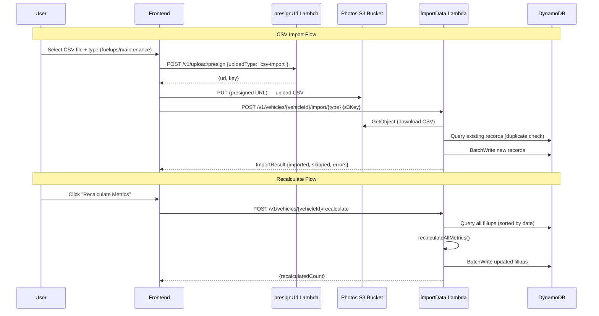

# Design Document: Fuelly CSV Import & Metrics Recalculation

## Overview

This feature adds two capabilities to PawsitiveMileage:

1. **Fuelly CSV Import** — Users upload Fuelly-exported CSV files (fuelups or maintenance) via the existing presigned URL flow. A new Lambda handler parses the CSV, transforms rows into PawsitiveMileage records, checks for duplicates, and batch-writes them to DynamoDB.

2. **Metrics Recalculation** — A new API endpoint fetches all fillups for a vehicle, runs them through the existing `recalculateAllMetrics()` function in `metrics.ts`, and writes the updated records back. This is triggered via a "Recalculate Metrics" button on the vehicle detail page.

Both features reuse existing infrastructure (Photos S3 bucket, presigned URL handler, metrics engine, DynamoDB batch writes) to minimize new resource creation.

## Architecture



### Key Design Decisions

1. **Single new Lambda handler** (`importData.ts`) — Handles both import and recalculate endpoints. These are closely related operations (both do bulk writes to fillups/maintenance tables) and share the same IAM permissions.

2. **Reuse Photos S3 bucket** — No new bucket needed. CSV files use the existing presigned URL flow with a new `csv-import` upload type and `text/csv` content type.

3. **Parse on the backend** — CSV parsing happens in the Lambda handler after downloading from S3, not on the frontend. This keeps validation and transformation logic server-side and avoids sending large payloads through API Gateway.

4. **Recalculate uses existing `recalculateAllMetrics()`** — The function in `api/src/lib/metrics.ts` already handles the full recalculation logic including partial fill accumulation. The new endpoint just orchestrates fetch → recalculate → write.

5. **Duplicate detection by date + odometer** — Simple and effective for Fuelly data where the same fillup will always have the same date and odometer reading. No need for content hashing.

## Components and Interfaces

### Backend Components

#### 1. CSV Parser Module (`api/src/lib/csv-parser.ts`)

Pure functions for parsing Fuelly CSV formats. No side effects, no DynamoDB calls.

```typescript
interface ParsedFuelup {
  date: string;              // from fuelup_date
  currencySpent: number;     // calculated: gallons * price
  gallonsAdded: number;      // from gallons
  odometerReading: number;   // from odometer
  isPartialFill: boolean;    // from partial_fuelup (0=false, 1=true)
  locationLat?: number;      // from latitude (if present)
  locationLng?: number;      // from longitude (if present)
  notes?: string;            // from notes (if present)
}

interface ParsedMaintenance {
  datePerformed: string;     // from service_date
  odometerAtService: number; // from odometer (0 if empty)
  cost: number;              // from price (0 if empty)
  customTypeName: string;    // from sub_service_types or "Other"
  notes?: string;            // from notes (if present)
}

interface ParseResult<T> {
  records: T[];
  skipped: SkippedRow[];
  totalRows: number;
}

interface SkippedRow {
  rowNumber: number;
  reason: string;
}

function parseFuelupsCsv(csvContent: string): ParseResult<ParsedFuelup>;
function parseMaintenanceCsv(csvContent: string): ParseResult<ParsedMaintenance>;
```

#### 2. Import Data Handler (`api/src/handlers/importData.ts`)

New Lambda handler with three route handlers:

```typescript
// POST /v1/vehicles/{vehicleId}/import/fuelups
// POST /v1/vehicles/{vehicleId}/import/maintenance
// POST /v1/vehicles/{vehicleId}/recalculate

interface ImportRequest {
  s3Key: string;  // S3 key of the uploaded CSV file
}

interface ImportResult {
  totalRows: number;
  imported: number;
  skipped: number;
  duplicates: number;
  errors: string[];
}

interface RecalculateResult {
  recalculatedCount: number;
}
```

#### 3. Presign URL Handler Changes (`api/src/handlers/presignUrl.ts`)

Minimal changes to the existing handler:
- Add `csv-import` to `ALLOWED_UPLOAD_TYPES`
- Add `text/csv` to `ALLOWED_CONTENT_TYPES`

### Frontend Components

#### 4. Import Dialog Component (`web/src/components/ImportDialog.tsx`)

A dialog component triggered from the vehicle detail page:

```typescript
interface ImportDialogProps {
  vehicleId: string;
  open: boolean;
  onOpenChange: (open: boolean) => void;
  onImportComplete: () => void;  // triggers data refetch
}
```

States: `idle` → `uploading` → `importing` → `success` | `error`

#### 5. Import API Client (`web/src/api/import.ts`)

TanStack Query mutations for import and recalculate:

```typescript
function useImportCsv(vehicleId: string);      // POST /v1/vehicles/{vehicleId}/import/{type}
function useRecalculateMetrics(vehicleId: string); // POST /v1/vehicles/{vehicleId}/recalculate
```

#### 6. Vehicle Detail Page Changes (`web/src/pages/VehicleDetailPage.tsx`)

Add two action buttons:
- "Import Data" — opens ImportDialog
- "Recalculate Metrics" — calls recalculate API directly with confirmation

### Infrastructure Changes

#### 7. API Stack Changes (`infra/lib/stacks/api-stack.ts`)

- Add `importData` Lambda function definition
- Grant read/write on Fillups, Maintenance, Vehicles tables
- Grant read on Photos S3 bucket (to download CSV files)
- Add API Gateway routes:
  - `POST /v1/vehicles/{vehicleId}/import/{type}`
  - `POST /v1/vehicles/{vehicleId}/recalculate`

## Data Models

### Fuelly Fuelups CSV → Fillup Mapping

| Fuelly Column | PawsitiveMileage Field | Transformation |
|---------------|----------------------|----------------|
| `fuelup_date` | `date` | Direct (ISO 8601 date) |
| `gallons` | `gallonsAdded` | `parseFloat()` |
| `price` | `currencySpent` | `gallons * price` (price is per-gallon) |
| `odometer` | `odometerReading` | `parseFloat()` |
| `partial_fuelup` | `isPartialFill` | `0` → `false`, `1` → `true` |
| `latitude` | `locationLat` | `parseFloat()` if non-empty |
| `longitude` | `locationLng` | `parseFloat()` if non-empty |
| `notes` | `notes` | Direct if non-empty |
| — | `isBusiness` | Default `false` |
| — | `fillupId` | Generated ULID |
| — | `vehicleId` | From URL path parameter |
| — | `userId` | From JWT token |
| — | Derived metrics | Set to `null` — recalculated after import |

### Fuelly Maintenance CSV → MaintenanceRecord Mapping

| Fuelly Column | PawsitiveMileage Field | Transformation |
|---------------|----------------------|----------------|
| `service_date` | `datePerformed` | Direct (ISO 8601 date) |
| `odometer` | `odometerAtService` | `parseFloat()`, default `0` if empty |
| `price` | `cost` | `parseFloat()`, default `0` if empty |
| `sub_service_types` | `customTypeName` | Humanize: `"oil_filter,engine_oil"` → `"Oil Filter, Engine Oil"`. If empty → `"Other"` |
| `notes` | `notes` | Direct if non-empty |
| — | `recordId` | Generated ULID |
| — | `vehicleId` | From URL path parameter |
| — | `userId` | From JWT token |

### Import Result Response

```typescript
{
  data: {
    totalRows: 107,
    imported: 106,
    skipped: 0,
    duplicates: 1,
    errors: []
  },
  requestId: "abc123"
}
```

### DynamoDB Write Patterns

**Fillup batch writes** — Each fillup record includes:
- `vehicleId` (PK), `fillupDateId` = `{date}#{fillupId}` (SK)
- `GSI1PK` = `userId`, `GSI1SK` = `date`
- `GSI2PK` = `"FILLUPS"`, `GSI2SK` = `date`

**Maintenance batch writes** — Each maintenance record includes:
- `vehicleId` (PK), `serviceDateId` = `{datePerformed}#{recordId}` (SK)
- `GSI1PK` = `userId`, `GSI1SK` = `datePerformed`

**Batch write strategy** — DynamoDB `BatchWriteItem` supports up to 25 items per request. Records are chunked into batches of 25 and written with retry logic for unprocessed items.


## Correctness Properties

*A property is a characteristic or behavior that should hold true across all valid executions of a system — essentially, a formal statement about what the system should do. Properties serve as the bridge between human-readable specifications and machine-verifiable correctness guarantees.*

### Property 1: Fuelup CSV round-trip field mapping

*For any* valid Fuelly fuelup CSV row with non-empty gallons, a valid date, and non-zero odometer, parsing the row should produce a `ParsedFuelup` where `date` equals the row's `fuelup_date`, `gallonsAdded` equals the row's `gallons`, `odometerReading` equals the row's `odometer`, `isPartialFill` equals `true` when `partial_fuelup` is `1` and `false` when `0`, and optional fields (`locationLat`, `locationLng`, `notes`) are present only when the corresponding CSV columns are non-empty.

**Validates: Requirements 2.1, 2.3, 2.4**

### Property 2: Currency spent calculation

*For any* Fuelly fuelup CSV row with positive `gallons` and positive `price` values, the parsed `currencySpent` should equal `gallons * price` (within floating-point tolerance).

**Validates: Requirements 2.2**

### Property 3: Invalid fuelup rows are skipped

*For any* Fuelly fuelup CSV row where `gallons` is empty or zero, or `fuelup_date` is empty or invalid, or `odometer` is empty or zero, the parser should exclude the row from the `records` array and include it in the `skipped` array with a descriptive reason.

**Validates: Requirements 2.6, 2.7, 2.8**

### Property 4: Maintenance CSV field mapping with defaults

*For any* valid Fuelly maintenance CSV row with a valid `service_date`, parsing the row should produce a `ParsedMaintenance` where `datePerformed` equals the row's `service_date`, `cost` equals the row's `price` (or `0` if empty), `odometerAtService` equals the row's `odometer` (or `0` if empty), `customTypeName` is derived from `sub_service_types` when non-empty (humanized: underscores replaced with spaces, title-cased) or is `"Other"` when `sub_service_types` is empty, and `notes` is present only when the CSV `notes` column is non-empty.

**Validates: Requirements 3.1, 3.2, 3.3, 3.4**

### Property 5: Parsed fillups are sorted chronologically

*For any* set of parsed fuelup records from a CSV file, after the import handler sorts them, each record's date should be less than or equal to the next record's date.

**Validates: Requirements 4.2**

### Property 6: Import result count invariant

*For any* CSV import operation, the `ImportResult` should satisfy: `totalRows == imported + skipped + duplicates`, and all counts should be non-negative.

**Validates: Requirements 4.5**

### Property 7: Duplicate detection prevents re-import

*For any* set of existing fillup records and a set of new parsed fillups, if a new fillup has the same `date` and `odometerReading` as an existing record, the import should mark it as a duplicate and not write it to DynamoDB. The same applies to maintenance records with matching `datePerformed` and `odometerAtService`.

**Validates: Requirements 5.1, 5.2, 5.3**

## Error Handling

| Scenario | Error Code | Message | HTTP Status |
|----------|-----------|---------|-------------|
| Missing or invalid request body | `VALIDATION_ERROR` | "Invalid or missing request body" | 400 |
| Missing `s3Key` in import request | `VALIDATION_ERROR` | "s3Key is required" | 400 |
| Invalid import type (not `fuelups` or `maintenance`) | `VALIDATION_ERROR` | "Import type must be 'fuelups' or 'maintenance'" | 400 |
| User does not own the vehicle | `FORBIDDEN` | "You do not own this vehicle" | 403 |
| Vehicle not found | `NOT_FOUND` | "Vehicle not found" | 404 |
| S3 object not found or inaccessible | `NOT_FOUND` | "CSV file not found" | 404 |
| CSV parsing fails entirely (not valid CSV) | `VALIDATION_ERROR` | "File is not a valid CSV" | 400 |
| CSV has no valid rows after parsing | `VALIDATION_ERROR` | "No valid records found in CSV" | 400 |
| DynamoDB batch write partial failure | Logged, included in `errors` array | Per-record error details | 200 (partial success) |
| Lambda timeout (unlikely for ~100 records) | `INTERNAL_ERROR` | "An internal error occurred" | 500 |

### Error Recovery

- **Partial imports are safe** — Each record is independently written. If the Lambda times out mid-import, already-written records persist. The user can re-run the import and duplicate detection will skip already-imported records.
- **Recalculate is idempotent** — Running recalculate multiple times produces the same result since `recalculateAllMetrics()` is a pure function of the fillup data.

## Testing Strategy

### Property-Based Tests (fast-check)

Each correctness property is implemented as a single property-based test with minimum 100 iterations. Tests are located in `api/tests/unit/csv-parser.test.ts` and `api/tests/unit/importData.test.ts`.

**Library**: `fast-check` 4.5.x (already in the project)

**Test tagging format**: `Feature: fuelly-import, Property {number}: {title}`

| Property | Test File | Generator Strategy |
|----------|-----------|-------------------|
| Property 1: Fuelup field mapping | `csv-parser.test.ts` | Generate random valid CSV rows with known field values, serialize to CSV string, parse, and verify field mapping |
| Property 2: Currency spent calculation | `csv-parser.test.ts` | Generate random positive `gallons` and `price` floats, verify `currencySpent ≈ gallons * price` |
| Property 3: Invalid fuelup rows skipped | `csv-parser.test.ts` | Generate CSV rows with one of: zero gallons, empty date, zero odometer. Verify row appears in `skipped` |
| Property 4: Maintenance field mapping | `csv-parser.test.ts` | Generate random valid maintenance CSV rows with varying `sub_service_types` and empty/present `price`/`odometer` |
| Property 5: Chronological sort | `importData.test.ts` | Generate random arrays of `ParsedFuelup` with random dates, sort, verify ascending order |
| Property 6: Import result invariant | `importData.test.ts` | Generate random import scenarios, verify `totalRows == imported + skipped + duplicates` |
| Property 7: Duplicate detection | `importData.test.ts` | Generate existing records and new records with some overlapping date+odometer pairs, verify duplicates are detected |

### Unit Tests (Vitest)

Unit tests cover specific examples, edge cases, and integration points:

- **CSV Parser**:
  - Parse the actual `SampleData/fuelly-fuelups.csv` file and verify record count and first/last record values
  - Parse the actual `SampleData/fuelly-maint.csv` file and verify record count
  - Baseline entry (mpg=0, miles=0) is parsed as a valid fillup
  - Multi-line notes in maintenance CSV are preserved
  - Empty CSV file returns zero records
  - CSV with only headers returns zero records

- **Import Handler**:
  - Vehicle ownership verification rejects unauthorized users
  - Missing s3Key returns validation error
  - Invalid import type returns validation error

- **Presign URL Handler**:
  - `csv-import` upload type is accepted
  - `text/csv` content type is accepted

### Test Configuration

```typescript
// vitest.config.ts — no changes needed, existing config covers api/tests/
// fast-check configured with numRuns: 100 per property test
```
