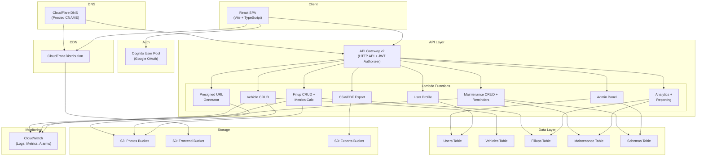

# Design Document: PawsitiveMileage

## Overview

PawsitiveMileage is a serverless vehicle fuel tracking and maintenance management application built on AWS. The architecture follows a three-tier pattern: a React/TypeScript SPA frontend served via CloudFront, a REST API layer powered by API Gateway v2 and Lambda functions, and a DynamoDB data layer with dedicated tables per entity type. Authentication is handled by Cognito with Google OAuth, and file storage (photos, exports) uses S3 with presigned URLs for direct browser uploads.

The system is designed for multi-environment deployment (test, staging, production) using AWS CDK, with all resources tagged and uniquely named per environment. The API is versioned from day one (`/v1/`) and structured to support future native mobile clients.

## Architecture



### Key Architectural Decisions

1. **Multi-table DynamoDB** over single-table design: Simpler to reason about, easier to manage capacity per entity, and clearer access patterns. GSIs are used where cross-entity queries are needed.

2. **Single-purpose Lambda functions**: Each API route gets its own Lambda to minimize cold start size and simplify debugging. Shared utilities are imported as a common module bundled by esbuild.

3. **Presigned URL uploads**: Photos are uploaded directly from the browser to S3 via presigned URLs, keeping Lambda functions lightweight and avoiding payload size limits.

4. **Environment-parameterized CDK**: A single CDK codebase deploys to test, staging, and production by accepting an environment parameter that drives resource naming, tagging, and domain configuration.

5. **API Gateway JWT Authorizer**: Native JWT validation at the gateway level means Lambda functions don't need to verify tokens, reducing code and latency.

## Components and Interfaces

### Frontend Components

```
web/
├── src/
│   ├── main.tsx                    # App entry point
│   ├── App.tsx                     # Root component with router
│   ├── auth/
│   │   ├── AuthProvider.tsx        # Cognito auth context (Amplify v6)
│   │   ├── ProtectedRoute.tsx      # Route guard for authenticated users
│   │   └── AdminRoute.tsx          # Route guard for admin users
│   ├── api/
│   │   ├── client.ts               # Axios/fetch wrapper with JWT injection
│   │   ├── vehicles.ts             # Vehicle API hooks (TanStack Query)
│   │   ├── fillups.ts              # Fillup API hooks
│   │   ├── maintenance.ts          # Maintenance API hooks
│   │   ├── analytics.ts            # Analytics API hooks
│   │   ├── admin.ts                # Admin API hooks
│   │   └── upload.ts               # Presigned URL + upload helpers
│   ├── pages/
│   │   ├── LoginPage.tsx
│   │   ├── GaragePage.tsx          # Vehicle list (active + archived tabs)
│   │   ├── VehicleDetailPage.tsx   # Single vehicle with fillups/maintenance
│   │   ├── AddFillupPage.tsx       # Fillup form (4 required fields)
│   │   ├── AddMaintenancePage.tsx  # Maintenance record form
│   │   ├── AnalyticsPage.tsx       # Charts and year-over-year
│   │   ├── ExportPage.tsx          # CSV/PDF export controls
│   │   ├── AdminUsersPage.tsx      # Admin: user management
│   │   ├── AdminSchemasPage.tsx    # Admin: maintenance schemas
│   │   └── AdminStatsPage.tsx      # Admin: platform monitoring
│   ├── components/
│   │   ├── VehicleCard.tsx         # Vehicle thumbnail card
│   │   ├── FillupList.tsx          # Fillup history table
│   │   ├── MaintenanceList.tsx     # Maintenance history table
│   │   ├── ReminderBanner.tsx      # Upcoming maintenance alerts
│   │   ├── PhotoUpload.tsx         # Camera/file upload component
│   │   ├── LocationPicker.tsx      # Geolocation + map + manual entry
│   │   ├── charts/
│   │   │   ├── MpgChart.tsx        # MPG over time (Recharts)
│   │   │   ├── SpendingChart.tsx   # Monthly spending (Recharts)
│   │   │   └── CostPerMileChart.tsx
│   │   └── SummaryCard.tsx         # Shareable annual summary
│   └── lib/
│       ├── metrics.ts              # Derived metrics calculation (shared)
│       ├── validators.ts           # Input validation functions
│       └── formatters.ts           # Currency, date, number formatters
```

### API Endpoints and Lambda Functions

| Method | Route | Lambda | Description |
|--------|-------|--------|-------------|
| GET | `/v1/user/profile` | userProfile | Get current user profile |
| PUT | `/v1/user/profile` | userProfile | Update user profile |
| DELETE | `/v1/user/profile` | userProfile | Delete account and all data |
| GET | `/v1/vehicles` | vehicleCrud | List user's vehicles (active/archived) |
| POST | `/v1/vehicles` | vehicleCrud | Create a vehicle |
| GET | `/v1/vehicles/{vehicleId}` | vehicleCrud | Get vehicle details |
| PUT | `/v1/vehicles/{vehicleId}` | vehicleCrud | Update vehicle |
| PATCH | `/v1/vehicles/{vehicleId}/archive` | vehicleCrud | Archive/unarchive vehicle |
| GET | `/v1/vehicles/{vehicleId}/fillups` | fillupCrud | List fillups for vehicle |
| POST | `/v1/vehicles/{vehicleId}/fillups` | fillupCrud | Create fillup (triggers metric calc) |
| GET | `/v1/vehicles/{vehicleId}/fillups/{fillupId}` | fillupCrud | Get fillup detail |
| PUT | `/v1/vehicles/{vehicleId}/fillups/{fillupId}` | fillupCrud | Update fillup (triggers recalc) |
| DELETE | `/v1/vehicles/{vehicleId}/fillups/{fillupId}` | fillupCrud | Delete fillup (triggers recalc) |
| GET | `/v1/vehicles/{vehicleId}/maintenance` | maintenanceCrud | List maintenance records |
| POST | `/v1/vehicles/{vehicleId}/maintenance` | maintenanceCrud | Create maintenance record |
| PUT | `/v1/vehicles/{vehicleId}/maintenance/{recordId}` | maintenanceCrud | Update maintenance record |
| DELETE | `/v1/vehicles/{vehicleId}/maintenance/{recordId}` | maintenanceCrud | Delete maintenance record |
| GET | `/v1/vehicles/{vehicleId}/maintenance/reminders` | maintenanceCrud | Get upcoming reminders |
| GET | `/v1/vehicles/{vehicleId}/analytics` | analytics | Get analytics data |
| GET | `/v1/vehicles/{vehicleId}/analytics/yoy` | analytics | Year-over-year comparison |
| POST | `/v1/vehicles/{vehicleId}/summary-card` | analytics | Generate summary card image |
| GET | `/v1/vehicles/{vehicleId}/export/fillups` | exportData | Export fillups as CSV |
| GET | `/v1/vehicles/{vehicleId}/export/maintenance` | exportData | Export maintenance as CSV |
| POST | `/v1/vehicles/{vehicleId}/export/pdf` | exportData | Generate PDF report |
| POST | `/v1/upload/presign` | presignUrl | Generate presigned S3 upload URL |
| GET | `/v1/admin/users` | adminUsers | List all users (admin only) |
| PATCH | `/v1/admin/users/{userId}/admin` | adminUsers | Set/remove admin flag |
| GET | `/v1/admin/schemas` | adminSchemas | List maintenance schemas |
| POST | `/v1/admin/schemas` | adminSchemas | Create maintenance schema |
| PUT | `/v1/admin/schemas/{schemaId}` | adminSchemas | Update maintenance schema |
| PATCH | `/v1/admin/schemas/{schemaId}/active` | adminSchemas | Activate/deactivate schema |
| GET | `/v1/admin/stats` | adminStats | Get platform statistics |

### Shared Lambda Utilities

```
api/
├── src/
│   ├── handlers/
│   │   ├── userProfile.ts
│   │   ├── vehicleCrud.ts
│   │   ├── fillupCrud.ts
│   │   ├── maintenanceCrud.ts
│   │   ├── analytics.ts
│   │   ├── exportData.ts
│   │   ├── presignUrl.ts
│   │   ├── adminUsers.ts
│   │   ├── adminSchemas.ts
│   │   └── adminStats.ts
│   ├── lib/
│   │   ├── dynamo.ts               # DynamoDB client + helpers
│   │   ├── s3.ts                   # S3 client + presigned URL generation
│   │   ├── auth.ts                 # Extract userId from JWT claims
│   │   ├── response.ts             # Standardized API response formatting
│   │   ├── validation.ts           # Request body validation
│   │   ├── metrics.ts              # Derived metrics calculation engine
│   │   └── logger.ts               # Structured JSON logger
│   └── types/
│       ├── vehicle.ts
│       ├── fillup.ts
│       ├── maintenance.ts
│       ├── schema.ts
│       └── user.ts
```

### Derived Metrics Calculation Engine

The metrics calculation is the core business logic. It lives in `api/src/lib/metrics.ts` and is also mirrored in `web/src/lib/metrics.ts` for client-side preview.

```typescript
interface FillupInput {
  date: string;           // ISO 8601
  currencySpent: number;  // e.g., 45.50
  gallonsAdded: number;   // e.g., 12.5
  odometerReading: number; // e.g., 45230
  isPartialFill: boolean;
}

interface DerivedMetrics {
  pricePerGallon: number | null;
  milesSinceLastFillup: number | null;
  mpg: number | null;
  costPerMile: number | null;
  daysSinceLastFillup: number | null;
}

function calculateDerivedMetrics(
  current: FillupInput,
  previous: FillupInput | null,
  accumulatedGallons: number,  // from partial fills
  accumulatedMiles: number     // from partial fills
): DerivedMetrics {
  const pricePerGallon = current.currencySpent / current.gallonsAdded;

  if (!previous) {
    return { pricePerGallon, milesSinceLastFillup: null, mpg: null, costPerMile: null, daysSinceLastFillup: null };
  }

  const milesSinceLastFillup = current.odometerReading - previous.odometerReading;
  const daysSinceLastFillup = daysBetween(current.date, previous.date);

  if (current.isPartialFill) {
    // Partial fill: record miles and gallons but skip MPG
    return { pricePerGallon, milesSinceLastFillup, mpg: null, costPerMile: null, daysSinceLastFillup };
  }

  // Full fill: use accumulated values if there were preceding partial fills
  const totalGallons = accumulatedGallons + current.gallonsAdded;
  const totalMiles = accumulatedMiles + milesSinceLastFillup;
  const mpg = totalMiles / totalGallons;
  const costPerMile = current.currencySpent / milesSinceLastFillup;

  return { pricePerGallon, milesSinceLastFillup, mpg, costPerMile, daysSinceLastFillup };
}
```

### Maintenance Reminder Calculation

```typescript
interface ReminderInput {
  schemaName: string;
  mileageInterval: number | null;   // e.g., 5000
  timeIntervalDays: number | null;  // e.g., 180
  lastServiceOdometer: number;
  lastServiceDate: string;          // ISO 8601
  currentOdometer: number;
  currentDate: string;              // ISO 8601
}

interface Reminder {
  schemaName: string;
  type: 'mileage' | 'time' | 'both';
  mileageRemaining: number | null;
  daysRemaining: number | null;
  isOverdue: boolean;
}

function calculateReminder(input: ReminderInput): Reminder | null {
  const mileageRemaining = input.mileageInterval
    ? (input.lastServiceOdometer + input.mileageInterval) - input.currentOdometer
    : null;
  const daysRemaining = input.timeIntervalDays
    ? (daysBetween(input.lastServiceDate, input.currentDate) - input.timeIntervalDays) * -1
    : null;

  // Only generate reminder if within threshold (e.g., 500 miles or 30 days)
  const mileageApproaching = mileageRemaining !== null && mileageRemaining <= 500;
  const timeApproaching = daysRemaining !== null && daysRemaining <= 30;

  if (!mileageApproaching && !timeApproaching) return null;

  return {
    schemaName: input.schemaName,
    type: mileageApproaching && timeApproaching ? 'both' : mileageApproaching ? 'mileage' : 'time',
    mileageRemaining,
    daysRemaining,
    isOverdue: (mileageRemaining !== null && mileageRemaining < 0) || (daysRemaining !== null && daysRemaining < 0),
  };
}
```

## Data Models

### DynamoDB Table Definitions

#### Users Table
- **Table Name**: `pawsitivemileage-users-{env}`
- **Partition Key**: `userId` (String) — Cognito sub
- **Attributes**: email, displayName, isAdmin, createdAt, updatedAt
- **GSI1**: `GSI1PK` = "USERS", `GSI1SK` = createdAt (for admin listing)

#### Vehicles Table
- **Table Name**: `pawsitivemileage-vehicles-{env}`
- **Partition Key**: `userId` (String)
- **Sort Key**: `vehicleId` (String) — ULID
- **Attributes**: nickname, make, model, year, trim, color, vin, licensePlate, tankSize, fuelType, photoKey, isArchived, createdAt, updatedAt
- **GSI1**: `GSI1PK` = "VEHICLES", `GSI1SK` = createdAt (for admin stats)

#### Fillups Table
- **Table Name**: `pawsitivemileage-fillups-{env}`
- **Partition Key**: `vehicleId` (String)
- **Sort Key**: `fillupDate#fillupId` (String) — composite for date ordering
- **Attributes**: userId, date, currencySpent, gallonsAdded, odometerReading, isPartialFill, pricePerGallon, milesSinceLastFillup, mpg, costPerMile, daysSinceLastFillup, locationLat, locationLng, stationName, address, receiptPhotoKey, notes, createdAt, updatedAt
- **GSI1**: `GSI1PK` = userId, `GSI1SK` = date (for cross-vehicle queries and admin)
- **GSI2**: `GSI2PK` = "FILLUPS", `GSI2SK` = date (for admin aggregate stats)

#### Maintenance Table
- **Table Name**: `pawsitivemileage-maintenance-{env}`
- **Partition Key**: `vehicleId` (String)
- **Sort Key**: `serviceDate#recordId` (String) — composite for date ordering
- **Attributes**: userId, schemaId, schemaName, datePerformed, odometerAtService, cost, location, notes, receiptPhotoKey, customTypeName, createdAt, updatedAt
- **GSI1**: `GSI1PK` = userId, `GSI1SK` = datePerformed (for cross-vehicle queries)

#### Maintenance Schemas Table
- **Table Name**: `pawsitivemileage-schemas-{env}`
- **Partition Key**: `schemaId` (String) — ULID
- **Attributes**: name, description, defaultMileageInterval, defaultTimeIntervalDays, category, isActive, createdAt, updatedAt

#### Vehicle Maintenance Overrides (stored in Vehicles Table)
- Custom intervals are stored as a map attribute on the Vehicle record: `maintenanceOverrides: { [schemaId]: { mileageInterval, timeIntervalDays } }`

### TypeScript Type Definitions

```typescript
// Shared types used by both frontend and backend

interface User {
  userId: string;
  email: string;
  displayName: string;
  isAdmin: boolean;
  createdAt: string;
  updatedAt: string;
}

interface Vehicle {
  userId: string;
  vehicleId: string;
  nickname: string;
  make: string;
  model: string;
  year: number;
  trim?: string;
  color?: string;
  vin?: string;
  licensePlate?: string;
  tankSize?: number;
  fuelType?: string;
  photoKey?: string;
  isArchived: boolean;
  maintenanceOverrides?: Record<string, { mileageInterval?: number; timeIntervalDays?: number }>;
  createdAt: string;
  updatedAt: string;
}

interface Fillup {
  vehicleId: string;
  fillupId: string;
  userId: string;
  date: string;
  currencySpent: number;
  gallonsAdded: number;
  odometerReading: number;
  isPartialFill: boolean;
  // Derived metrics
  pricePerGallon: number | null;
  milesSinceLastFillup: number | null;
  mpg: number | null;
  costPerMile: number | null;
  daysSinceLastFillup: number | null;
  // Optional
  locationLat?: number;
  locationLng?: number;
  stationName?: string;
  address?: string;
  receiptPhotoKey?: string;
  notes?: string;
  createdAt: string;
  updatedAt: string;
}

interface MaintenanceRecord {
  vehicleId: string;
  recordId: string;
  userId: string;
  schemaId?: string;
  schemaName?: string;
  customTypeName?: string;
  datePerformed: string;
  odometerAtService: number;
  cost: number;
  location?: string;
  notes?: string;
  receiptPhotoKey?: string;
  createdAt: string;
  updatedAt: string;
}

interface MaintenanceSchema {
  schemaId: string;
  name: string;
  description: string;
  defaultMileageInterval: number | null;
  defaultTimeIntervalDays: number | null;
  category: string;
  isActive: boolean;
  createdAt: string;
  updatedAt: string;
}
```

### CDK Infrastructure Structure

```
infra/
├── bin/
│   └── app.ts                      # CDK app entry, reads env parameter
├── lib/
│   ├── config.ts                   # Environment config (domains, naming)
│   ├── tags.ts                     # Resource tagging helper
│   ├── stacks/
│   │   ├── auth-stack.ts           # Cognito User Pool, Google IdP, App Client
│   │   ├── database-stack.ts       # All DynamoDB tables + GSIs
│   │   ├── storage-stack.ts        # S3 buckets (photos, frontend, exports)
│   │   ├── api-stack.ts            # API Gateway, Lambda functions, JWT authorizer
│   │   ├── frontend-stack.ts       # CloudFront distribution, S3 deployment
│   │   └── monitoring-stack.ts     # CloudWatch dashboards, alarms
│   └── constructs/
│       └── lambda-function.ts      # Reusable Lambda construct with defaults
```

### Environment Configuration

```typescript
interface EnvironmentConfig {
  envName: 'test' | 'staging' | 'production';
  frontendDomain: string;
  apiDomain: string;
  resourcePrefix: string;
  tags: Record<string, string>;
}

const environments: Record<string, EnvironmentConfig> = {
  test: {
    envName: 'test',
    frontendDomain: 'pawsitivemileagetest.bourbonlab.net',
    apiDomain: 'pawsitivemileageapitest.bourbonlab.net',
    resourcePrefix: 'pawsitivemileage-test',
    tags: { Environment: 'test', Project: 'PawsitiveMileage', ManagedBy: 'CDK' },
  },
  staging: {
    envName: 'staging',
    frontendDomain: 'pawsitivemileagestaging.bourbonlab.net',
    apiDomain: 'pawsitivemileageapistaging.bourbonlab.net',
    resourcePrefix: 'pawsitivemileage-staging',
    tags: { Environment: 'staging', Project: 'PawsitiveMileage', ManagedBy: 'CDK' },
  },
  production: {
    envName: 'production',
    frontendDomain: 'pawsitivemileage.bourbonlab.net',
    apiDomain: 'pawsitivemileageapi.bourbonlab.net',
    resourcePrefix: 'pawsitivemileage-production',
    tags: { Environment: 'production', Project: 'PawsitiveMileage', ManagedBy: 'CDK' },
  },
};
```

## Correctness Properties

*A property is a characteristic or behavior that should hold true across all valid executions of a system — essentially, a formal statement about what the system should do. Properties serve as the bridge between human-readable specifications and machine-verifiable correctness guarantees.*

### Property 1: Derived metrics formula correctness

*For any* two consecutive Fillups for the same Vehicle where both are non-partial fills, the calculated Derived_Metrics SHALL satisfy: pricePerGallon = currencySpent / gallonsAdded, milesSinceLastFillup = currentOdometer - previousOdometer, mpg = milesSinceLastFillup / gallonsAdded, costPerMile = currencySpent / milesSinceLastFillup, and daysSinceLastFillup = daysBetween(currentDate, previousDate).

**Validates: Requirements 3.2**

### Property 2: First fillup produces only price per gallon

*For any* Fillup that is the first for a Vehicle, the only non-null derived metric SHALL be pricePerGallon (= currencySpent / gallonsAdded), and milesSinceLastFillup, mpg, costPerMile, and daysSinceLastFillup SHALL all be null.

**Validates: Requirements 3.3**

### Property 3: Partial fill accumulation

*For any* sequence of Fillups where one or more consecutive Partial_Fills are followed by a non-partial Fillup, the non-partial Fillup's MPG SHALL equal the total accumulated miles (from the last non-partial Fillup to the current odometer) divided by the total accumulated gallons (sum of all partial fills' gallons plus the current fillup's gallons), and each Partial_Fill's MPG SHALL be null.

**Validates: Requirements 3.4, 3.5**

### Property 4: Odometer monotonicity validation

*For any* Fillup where the odometer reading is less than or equal to the previous Fillup's odometer reading for the same Vehicle, the system SHALL reject the Fillup with a validation error.

**Validates: Requirements 3.9**

### Property 5: Fillup edit/delete triggers recalculation consistency

*For any* ordered sequence of Fillups for a Vehicle, if any Fillup in the sequence is edited or deleted, the Derived_Metrics of all subsequent Fillups SHALL be recalculated and match the values that would result from processing the modified sequence from scratch.

**Validates: Requirements 3.6**

### Property 6: Vehicle validation requires all mandatory fields

*For any* Vehicle input, the system SHALL accept the input if and only if nickname, make, model, and year are all present and non-empty. Optional fields (trim, color, VIN, licensePlate, tankSize, fuelType, photo) may be absent without causing rejection.

**Validates: Requirements 2.1**

### Property 7: Archive/unarchive round-trip

*For any* active Vehicle, archiving and then unarchiving SHALL restore the Vehicle to active status with all associated Fillup and Maintenance_Record data intact and unchanged.

**Validates: Requirements 2.3, 2.6**

### Property 8: Active/archived vehicle filtering

*For any* set of Vehicles belonging to a User, querying for active vehicles SHALL return exactly those where isArchived is false, and querying for archived vehicles SHALL return exactly those where isArchived is true. The union of both sets SHALL equal the complete set of the User's Vehicles.

**Validates: Requirements 2.4, 2.5**

### Property 9: Vehicle edit round-trip

*For any* Vehicle and any valid field update, reading the Vehicle after the update SHALL reflect exactly the changed fields with all other fields unchanged.

**Validates: Requirements 2.2**

### Property 10: S3 key user-scoping

*For any* presigned URL generated for a photo upload (vehicle photo or receipt photo), the S3 object key SHALL contain the authenticated userId as a path prefix, ensuring photos are stored in user-scoped namespaces.

**Validates: Requirements 2.7, 3.7**

### Property 11: Maintenance schema CRUD round-trip

*For any* valid Maintenance_Schema, creating and then reading the schema SHALL return an equivalent object. Updating any field and then reading SHALL reflect the update.

**Validates: Requirements 4.1, 4.2**

### Property 12: Deactivated schema exclusion

*For any* set of Maintenance_Schemas with mixed active/inactive status, querying for available schemas SHALL return only those where isActive is true, while existing Maintenance_Records referencing deactivated schemas SHALL remain intact and queryable.

**Validates: Requirements 4.3**

### Property 13: Maintenance record creation with schema reference

*For any* valid Maintenance_Record input referencing an active Maintenance_Schema, the created record SHALL contain all specified fields (datePerformed, odometerAtService, cost) and the correct schemaId and schemaName.

**Validates: Requirements 4.4**

### Property 14: Reminder calculation correctness

*For any* Vehicle with a last service record for a Maintenance_Schema, the reminder calculation SHALL produce a mileage reminder when (lastServiceOdometer + mileageInterval - currentOdometer) is within the threshold, and a time reminder when (lastServiceDate + timeIntervalDays - currentDate) is within the threshold. Custom vehicle overrides SHALL take precedence over schema defaults.

**Validates: Requirements 4.6, 4.7, 4.8**

### Property 15: Maintenance and fillup records sorted by date

*For any* Vehicle, querying Fillups or Maintenance_Records SHALL return results in chronological order by date.

**Validates: Requirements 4.9, 9.3, 9.4**

### Property 16: Fillup input validation

*For any* Fillup input, the system SHALL accept it if and only if date, currencySpent (> 0), gallonsAdded (> 0), and odometerReading (> 0) are all present and valid.

**Validates: Requirements 3.1**

### Property 17: Analytics aggregation correctness

*For any* set of Fillups for a Vehicle, the analytics aggregation SHALL correctly compute: average MPG (mean of non-null MPG values), total spending (sum of currencySpent), total miles (max odometer - min odometer), and monthly breakdowns that sum to the totals.

**Validates: Requirements 6.1**

### Property 18: Year-over-year comparison correctness

*For any* set of Fillups spanning multiple calendar years, the year-over-year comparison SHALL produce per-year summaries where each year's total spent, total gallons, average MPG, and total miles are independently correct, and trend indicators correctly reflect the direction of change between consecutive years.

**Validates: Requirements 6.2**

### Property 19: Summary card data completeness

*For any* Vehicle and selected year, the Summary_Card data SHALL include total miles, total fuel cost, average MPG, number of fillups, and total maintenance cost, all matching the values computed from the underlying Fillup and Maintenance_Record data for that year.

**Validates: Requirements 6.3**

### Property 20: CSV export data completeness

*For any* set of Fillups or Maintenance_Records within a date range, the generated CSV SHALL contain one row per record with all fields present, and parsing the CSV back SHALL produce data equivalent to the original records.

**Validates: Requirements 6.5, 6.6**

### Property 21: Admin authorization enforcement

*For any* API request to an admin endpoint, the system SHALL return 403 if the requesting User does not have the isAdmin flag set to true.

**Validates: Requirements 7.1**

### Property 22: Admin flag toggle round-trip

*For any* User, setting the admin flag to true and then reading the User SHALL show isAdmin as true. Setting it to false and reading SHALL show isAdmin as false.

**Validates: Requirements 7.3**

### Property 23: Tenant isolation

*For any* authenticated User, all data queries SHALL return only records belonging to that User's userId. No query SHALL return records belonging to a different userId.

**Validates: Requirements 8.4, 9.2, 11.2**

### Property 24: Error handler returns generic 500

*For any* Lambda handler, when an unhandled exception occurs, the response SHALL have status code 500 with a generic error message body, and the actual error details SHALL be written to the structured JSON log.

**Validates: Requirements 8.5**

### Property 25: Cascading account deletion

*For any* User with associated Vehicles, Fillups, Maintenance_Records, and S3 objects, after account deletion, querying for any of that User's data SHALL return empty results, and all associated S3 keys SHALL no longer exist.

**Validates: Requirements 11.1, 11.3**

### Property 26: User profile creation completeness

*For any* valid Cognito user attributes (sub, email, name), the created user profile SHALL contain userId matching the Cognito sub, email, displayName, and non-null createdAt and updatedAt timestamps.

**Validates: Requirements 1.3**

## Error Handling

### API Error Response Format

All Lambda functions return errors in a consistent format:

```typescript
interface ApiErrorResponse {
  statusCode: number;
  body: {
    error: string;      // Human-readable error message
    code: string;       // Machine-readable error code
    requestId: string;  // For support/debugging correlation
  };
}
```

### Error Categories

| Status Code | Code | Scenario |
|-------------|------|----------|
| 400 | `VALIDATION_ERROR` | Missing required fields, invalid data types, odometer not increasing |
| 401 | `UNAUTHORIZED` | Missing or invalid JWT (handled by API Gateway) |
| 403 | `FORBIDDEN` | Non-admin accessing admin endpoints |
| 404 | `NOT_FOUND` | Vehicle, fillup, or record not found (or belongs to another user) |
| 409 | `CONFLICT` | Duplicate resource creation attempt |
| 500 | `INTERNAL_ERROR` | Unhandled exceptions — generic message returned, details logged |

### Error Handling Strategy

1. **Validation errors**: Caught at the handler level before any DynamoDB operations. Return 400 with specific field-level error messages.
2. **Authorization errors**: Admin endpoints check the isAdmin flag from JWT claims. Return 403 if not admin.
3. **Not found / tenant isolation**: All queries include userId. If a resource isn't found for the authenticated user, return 404 (never reveal that the resource exists for another user).
4. **DynamoDB errors**: Conditional check failures (e.g., optimistic locking) return 409. Throttling errors are retried with exponential backoff by the SDK.
5. **Unhandled errors**: Caught by a top-level try/catch wrapper in each handler. Error is logged with full stack trace in structured JSON. A generic 500 response is returned to the client.

### Structured Logging

```typescript
// Every log entry includes:
{
  level: 'INFO' | 'WARN' | 'ERROR',
  message: string,
  requestId: string,
  userId: string,
  handler: string,
  timestamp: string,
  // ERROR level additionally includes:
  error?: { name: string, message: string, stack: string }
}
```

## Testing Strategy

### Testing Framework

- **Unit & Integration Tests**: Vitest (fast, TypeScript-native, Vite-compatible)
- **Property-Based Testing**: fast-check (mature PBT library for TypeScript/JavaScript)
- **Frontend Component Tests**: Vitest + React Testing Library
- **Infrastructure Tests**: CDK assertions (`aws-cdk-lib/assertions`)

### Dual Testing Approach

**Unit Tests** focus on:
- Specific examples demonstrating correct behavior (e.g., sample data from FuelEfficency.csv)
- Edge cases (first fillup, partial fills, zero values, boundary conditions)
- Error conditions (invalid input, missing fields, unauthorized access)
- Integration points between components

**Property-Based Tests** focus on:
- Universal properties that hold for all valid inputs
- Comprehensive input coverage through randomization
- Each property test runs a minimum of 100 iterations
- Each test is tagged with: `Feature: pawsitive-mileage, Property {N}: {title}`

### Test Organization

```
api/
├── src/
│   └── ...
├── tests/
│   ├── unit/
│   │   ├── metrics.test.ts          # Derived metrics calculation
│   │   ├── reminders.test.ts        # Reminder calculation
│   │   ├── validation.test.ts       # Input validation
│   │   ├── auth.test.ts             # Auth helper functions
│   │   └── response.test.ts         # Response formatting
│   └── property/
│       ├── metrics.property.test.ts  # Properties 1-5, 16
│       ├── vehicles.property.test.ts # Properties 6-10
│       ├── maintenance.property.test.ts # Properties 11-15
│       ├── analytics.property.test.ts   # Properties 17-20
│       ├── admin.property.test.ts       # Properties 21-22
│       ├── isolation.property.test.ts   # Properties 23-25
│       └── users.property.test.ts       # Property 26
web/
├── src/
│   └── ...
├── tests/
│   ├── components/                   # React component tests
│   └── lib/
│       └── metrics.test.ts           # Client-side metrics (mirrors API tests)
infra/
├── test/
│   └── stacks.test.ts               # CDK assertion tests for all stacks
```

### Property Test Configuration

Each property-based test must:
1. Run a minimum of 100 iterations (`fc.assert(property, { numRuns: 100 })`)
2. Include a comment referencing the design property number
3. Use the tag format: `Feature: pawsitive-mileage, Property {N}: {title}`
4. Use fast-check arbitraries to generate valid inputs

### Key Test Generators (fast-check Arbitraries)

```typescript
// Fillup generator
const fillupArb = fc.record({
  date: fc.date({ min: new Date('2020-01-01'), max: new Date('2030-12-31') }).map(d => d.toISOString()),
  currencySpent: fc.float({ min: 0.01, max: 200, noNaN: true }),
  gallonsAdded: fc.float({ min: 0.1, max: 40, noNaN: true }),
  odometerReading: fc.integer({ min: 1, max: 500000 }),
  isPartialFill: fc.boolean(),
});

// Vehicle generator
const vehicleArb = fc.record({
  nickname: fc.string({ minLength: 1, maxLength: 50 }),
  make: fc.string({ minLength: 1, maxLength: 30 }),
  model: fc.string({ minLength: 1, maxLength: 30 }),
  year: fc.integer({ min: 1900, max: 2030 }),
});

// Ordered fillup sequence generator (monotonically increasing odometer)
const fillupSequenceArb = fc.array(fillupArb, { minLength: 2, maxLength: 20 })
  .map(fillups => fillups.sort((a, b) => a.odometerReading - b.odometerReading));
```
