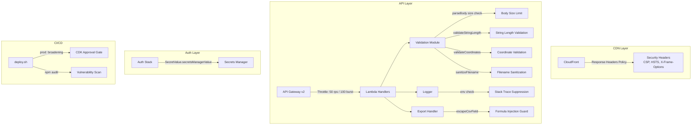

# Design Document: Security Hardening

## Overview

This design addresses 12 security findings across the PawsitiveMileage stack. The changes fall into four categories:

1. **Secret management** — Move the Google OAuth client secret from plaintext CDK context to AWS Secrets Manager (Req 1)
2. **Input validation hardening** — Add body size limits, string length validation, coordinate range checks, filename sanitization, and content type whitelisting to the API layer (Req 2, 3, 4, 8, 9)
3. **Output sanitization** — Fix CSV formula injection and suppress production stack traces (Req 6, 10)
4. **Infrastructure hardening** — Add API Gateway throttling, CloudFront security headers, production deployment approval gates, and dependency vulnerability scanning (Req 5, 7, 11, 12)

All changes are backward-compatible. No data migrations are required. The validation module changes are additive — existing functions are extended, not replaced.

## Architecture

The security hardening touches three layers but does not change the overall architecture:



## Components and Interfaces

### 1. Validation Module (`api/src/lib/validation.ts`)

The existing validation module gains three new functions and one modified function.

#### Modified: `parseBody(body, maxBytes?)`

```typescript
/**
 * Parse a JSON request body with size enforcement.
 * Returns null if body is missing, exceeds maxBytes, or is invalid JSON.
 */
export function parseBody(
  body: string | null | undefined,
  maxBytes: number = 65_536
): Record<string, unknown> | null;
```

The `maxBytes` parameter defaults to 65,536 (64 KB). The check uses `body.length` which measures UTF-16 code units — sufficient since API Gateway delivers the body as a string and the 10 MB gateway limit is the true upper bound.

#### New: `validateStringLength(body, limits)`

```typescript
export function validateStringLength(
  body: Record<string, unknown>,
  limits: Record<string, number>
): ValidationError[];
```

Iterates over `limits` entries. For each field present in `body` that is a string, checks `value.length <= limit`. Returns a `ValidationError` for each violation.

#### New: `validateCoordinates(body)`

```typescript
export function validateCoordinates(
  body: Record<string, unknown>
): ValidationError[];
```

If `locationLat` is present, validates it is a number in [-90, 90]. If `locationLng` is present, validates it is a number in [-180, 180]. Returns errors for out-of-range or wrong-type values.

#### New: `sanitizeFilename(filename)`

```typescript
export function sanitizeFilename(filename: string): string | null;
```

Processing steps:
1. Strip path separators (`/` and `\`)
2. Replace characters outside `[a-zA-Z0-9._\- ]` with empty string
3. Trim whitespace
4. Truncate to 255 characters
5. Return `null` if the result is empty

### 2. Export Handler (`api/src/handlers/exportData.ts`)

#### Modified: `escapeCsvField(value)`

Add formula injection guard before existing CSV escaping logic. If the stringified value starts with `=`, `+`, `-`, `@`, `\t`, or `\r`, prefix with a single quote `'`.

```typescript
function escapeCsvField(value: unknown): string {
  if (value === null || value === undefined) return '';
  const str = String(value);
  const sanitized = /^[=+\-@\t\r]/.test(str) ? `'${str}` : str;
  if (sanitized.includes(',') || sanitized.includes('"') || sanitized.includes('\n') || sanitized.includes('\r')) {
    return `"${sanitized.replace(/"/g, '""')}"`;
  }
  return sanitized;
}
```

### 3. Presign Handler (`api/src/handlers/presignUrl.ts`)

#### Content type whitelist

```typescript
const ALLOWED_CONTENT_TYPES = ['image/jpeg', 'image/png', 'image/webp', 'image/heic'] as const;
```

Validate `contentType` against this list before generating the presigned URL. Return a 400 error listing allowed types if invalid.

#### Filename sanitization

Call `sanitizeFilename()` from the validation module on the `filename` field. If the result is `null`, return a 400 error.

### 4. Logger (`api/src/lib/logger.ts`)

#### Stack trace suppression

Check `process.env.ENVIRONMENT` at log time. In production, omit the `stack` field from the error object in structured log output. In non-production, include the full stack trace as before.

```typescript
if (err instanceof Error) {
  const isProduction = process.env.ENVIRONMENT === 'production';
  entry.error = {
    name: err.name,
    message: err.message,
    ...(isProduction ? {} : { stack: err.stack ?? '' }),
  };
}
```

### 5. Auth Stack (`infra/lib/stacks/auth-stack.ts`)

#### Secrets Manager integration

Replace `cdk.SecretValue.unsafePlainText(googleClientSecret)` with `cdk.SecretValue.secretsManagerValue(secretName)`.

The secret name is passed via CDK context (`-c googleClientSecretArn=...`). The Auth Stack reads it with:

```typescript
const googleSecretName = this.node.tryGetContext('googleClientSecretArn');
const clientSecretValue = cdk.SecretValue.secretsManagerValue(googleSecretName);
```

The Secrets Manager secret must be pre-created (outside CDK) containing the raw Google client secret string. This is a one-time manual setup step.

### 6. API Stack (`infra/lib/stacks/api-stack.ts`)

#### Throttle configuration

Add throttle settings to the HTTP API's default stage:

```typescript
const stage = this.httpApi.defaultStage?.node.defaultChild as cdk.aws_apigatewayv2.CfnStage;
stage.defaultRouteSettings = {
  throttlingBurstLimit: 100,
  throttlingRateLimit: 50,
};
```

This uses the L1 escape hatch since `HttpApi` doesn't expose throttle settings directly on the L2 construct.

### 7. Frontend Stack (`infra/lib/stacks/frontend-stack.ts`)

#### Response Headers Policy

Create a `ResponseHeadersPolicy` with:

| Header | Value |
|--------|-------|
| Content-Security-Policy | `default-src 'self'; script-src 'self' 'unsafe-inline'; style-src 'self' 'unsafe-inline'; img-src 'self' data: https://*.tile.openstreetmap.org; font-src 'self'; connect-src 'self' https://{apiDomain} https://cognito-idp.*.amazonaws.com; frame-ancestors 'none'` |
| X-Frame-Options | DENY |
| X-Content-Type-Options | nosniff |
| Referrer-Policy | strict-origin-when-cross-origin |
| Strict-Transport-Security | max-age=31536000; includeSubDomains |

Attach the policy to the default behavior and the `/photos/*` additional behavior.

The CSP `connect-src` includes the API domain and Cognito endpoints. The `style-src 'unsafe-inline'` is needed for Tailwind CSS runtime styles. The `img-src` includes OpenStreetMap tiles for Leaflet maps.

### 8. Deploy Script (`deploy.sh`)

#### Production approval gate

Replace the hardcoded `--require-approval never` with a conditional:

```bash
if [[ "$DEPLOY_ENV" == "production" ]]; then
  APPROVAL_FLAG="--require-approval broadening"
else
  APPROVAL_FLAG="--require-approval never"
fi
```

#### Remove secret from CDK context

Remove `-c googleClientSecret="$GOOGLE_CLIENT_SECRET"` from the CDK context array. Add `-c googleClientSecretArn="$GOOGLE_CLIENT_SECRET_ARN"` instead, where `GOOGLE_CLIENT_SECRET_ARN` is a new `.env` variable containing the Secrets Manager secret name/ARN.

#### npm audit

Add after each `npm install` step:

```bash
npm audit --audit-level=high || warn "npm audit found vulnerabilities in ${dir}"
```

Non-blocking — prints a warning but does not fail the build.

### Handler Integration Points

Each handler that accepts user text input needs `validateStringLength` calls added. Here's the mapping:

| Handler | Fields | Limits |
|---------|--------|--------|
| `fillupCrud.ts` | stationName, address, notes | 255, 1000, 1000 |
| `vehicleCrud.ts` | make, model, trim, color, vin, licensePlate, notes | 100, 100, 100, 50, 17, 20, 1000 |
| `userProfile.ts` | displayName | 255 |
| `adminSchemas.ts` | name, description | 255, 1000 |
| `maintenanceCrud.ts` | notes, serviceName | 1000, 255 |

The `fillupCrud.ts` handler also needs `validateCoordinates(body)` added after existing validation.

## Data Models

No new data models are introduced. The changes are purely behavioral — validation, sanitization, and infrastructure configuration. All existing DynamoDB table schemas, S3 key patterns, and API response envelopes remain unchanged.

The only data-adjacent change is the `LogEntry` interface in `logger.ts`, where the `error.stack` field becomes optional:

```typescript
interface LogEntry {
  level: LogLevel;
  message: string;
  requestId: string;
  userId: string;
  handler: string;
  timestamp: string;
  error?: { name: string; message: string; stack?: string };
}
```


## Correctness Properties

*A property is a characteristic or behavior that should hold true across all valid executions of a system — essentially, a formal statement about what the system should do. Properties serve as the bridge between human-readable specifications and machine-verifiable correctness guarantees.*

### Property 1: Body size enforcement

*For any* string `body` and any positive integer `maxBytes`, if `body.length > maxBytes`, then `parseBody(body, maxBytes)` returns `null` without attempting JSON parsing. Conversely, if `body.length <= maxBytes` and `body` is not valid JSON, `parseBody` still returns `null`.

**Validates: Requirements 2.1, 2.3**

### Property 2: parseBody round-trip for valid JSON

*For any* valid JSON object `obj`, if `JSON.stringify(obj).length <= maxBytes`, then `parseBody(JSON.stringify(obj), maxBytes)` returns an object deeply equal to `obj`.

**Validates: Requirements 2.2**

### Property 3: String length validation rejects oversized fields

*For any* field name `f`, any positive integer `limit`, and any string `s` where `s.length > limit`, calling `validateStringLength({ [f]: s }, { [f]: limit })` returns a non-empty error array containing an error for field `f`. Conversely, if `s.length <= limit`, the error array for field `f` is empty.

**Validates: Requirements 3.2**

### Property 4: Coordinate range validation

*For any* number `lat` and `lng`, `validateCoordinates({ locationLat: lat, locationLng: lng })` returns an error for `locationLat` if and only if `lat < -90 || lat > 90`, and returns an error for `locationLng` if and only if `lng < -180 || lng > 180`.

**Validates: Requirements 4.1, 4.2**

### Property 5: CSV formula injection guard

*For any* string `s`, if `s` starts with one of `=`, `+`, `-`, `@`, `\t`, or `\r`, then the raw (un-CSV-escaped) output of `escapeCsvField(s)` begins with a single quote `'` followed by the original string. If `s` does not start with any of those characters, the output does not have a `'` prefix added.

**Validates: Requirements 6.1, 6.2**

### Property 6: Filename sanitization output invariants

*For any* input string `s`, if `sanitizeFilename(s)` returns a non-null result `r`, then: (a) `r` contains only characters matching `[a-zA-Z0-9._\- ]`, (b) `r.length <= 255`, and (c) `r.length > 0`.

**Validates: Requirements 8.1, 8.2, 8.3**

### Property 7: Filename sanitization rejects all-invalid inputs

*For any* string `s` composed entirely of characters outside `[a-zA-Z0-9._\- ]` (including path separators, special characters, etc.), `sanitizeFilename(s)` returns `null`.

**Validates: Requirements 8.4**

### Property 8: Content type whitelist

*For any* string `ct`, content type validation passes if and only if `ct` is one of `image/jpeg`, `image/png`, `image/webp`, or `image/heic`.

**Validates: Requirements 9.1**

### Property 9: Logger stack trace environment-conditional

*For any* `Error` object with a non-empty `stack`, when `ENVIRONMENT` is `production` the structured log entry's `error` object does not contain a `stack` field, and when `ENVIRONMENT` is not `production` the `error` object contains the full `stack` string.

**Validates: Requirements 10.1, 10.2**

## Error Handling

All validation errors follow the existing API response envelope pattern:

| Scenario | HTTP Status | Error Code | Message Pattern |
|----------|-------------|------------|-----------------|
| Body exceeds size limit | 400 | VALIDATION_ERROR | "Invalid or missing request body" |
| String field too long | 400 | VALIDATION_ERROR | "{field} must be at most {limit} characters" |
| Coordinate out of range | 400 | VALIDATION_ERROR | "locationLat must be between -90 and 90" |
| Invalid content type | 400 | VALIDATION_ERROR | "contentType must be one of: image/jpeg, image/png, image/webp, image/heic" |
| Empty sanitized filename | 400 | VALIDATION_ERROR | "filename contains no valid characters" |
| API throttle exceeded | 429 | (API Gateway) | Automatic 429 response from API Gateway |

No new error codes are introduced. All validation errors use the existing `VALIDATION_ERROR` code. The `parseBody` change is transparent to callers — it already returns `null` for invalid bodies, and all handlers already check for `null`.

## Testing Strategy

### Property-Based Tests (fast-check 4.5.x)

Each correctness property maps to a single property-based test with a minimum of 100 iterations. Tests go in `api/tests/unit/` alongside existing test files.

New test file: `api/tests/unit/security.test.ts`

| Property | Test Description | Generator Strategy |
|----------|------------------|--------------------|
| Property 1 | Body size enforcement | `fc.string()` with length > maxBytes |
| Property 2 | parseBody round-trip | `fc.jsonValue()` stringified within limit |
| Property 3 | String length validation | `fc.string()`, `fc.nat()` for limits |
| Property 4 | Coordinate range validation | `fc.double()` for lat/lng values |
| Property 5 | CSV formula injection guard | `fc.string()` with/without formula prefixes |
| Property 6 | Filename sanitization invariants | `fc.string()` (unicode range) |
| Property 7 | Filename all-invalid rejection | `fc.string()` filtered to disallowed chars |
| Property 8 | Content type whitelist | `fc.oneof(fc.constant(...allowed), fc.string())` |
| Property 9 | Logger stack trace suppression | `fc.string()` for error messages, toggle env |

Each test is tagged with: `Feature: security-hardening, Property {N}: {title}`

### Unit Tests

Unit tests complement property tests for specific examples and edge cases:

- `parseBody` with exactly 65,536 bytes (boundary)
- `parseBody` with `null`, `undefined`, empty string
- `validateStringLength` with empty string, exactly-at-limit string
- `validateCoordinates` with boundary values (-90, 90, -180, 180)
- `escapeCsvField` with each formula character individually
- `sanitizeFilename` with path traversal attempts (`../../etc/passwd`), unicode, empty string
- Content type validation with case variations (`Image/JPEG`)

### Infrastructure Tests

CDK infrastructure changes (throttling, security headers, Secrets Manager) are verified via `cdk synth` output inspection during deployment. These are not covered by property-based tests since they are declarative configuration.
