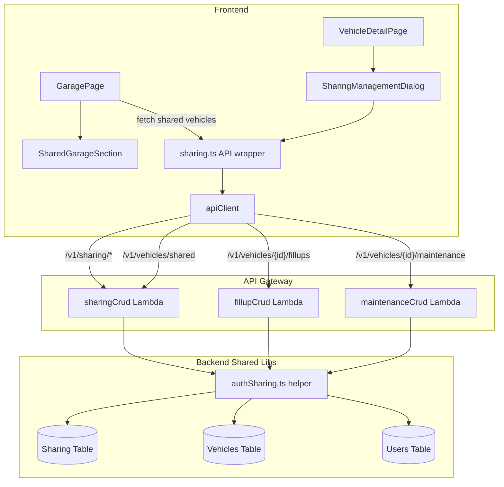

# Design Document: Shared Garage

## Overview

The Shared Garage feature enables vehicle owners to share access to their vehicles with other people identified by email address. Shared users see shared vehicles in a dedicated section on the Garage page and can interact with vehicle data according to their granted permission level (readonly, fuel-only, maintenance-only, or full).

The design introduces a new DynamoDB table for sharing records, a new Lambda handler for sharing CRUD operations, an authorization helper that extends existing ownership checks to support shared access, and frontend components for managing shares and displaying shared vehicles.

Key design decisions:
- **Email-based sharing without registration check**: Share records reference email addresses directly. No lookup is performed to verify whether the email belongs to a registered user. This prevents user enumeration attacks.
- **Lookup at access time**: When a logged-in user requests shared vehicles, the system queries the sharing table GSI by the user's email (from their Cognito profile). Only registered users who happen to match a shared email will see shared vehicles.
- **Separate handler**: A dedicated `sharingCrud` Lambda handler manages all sharing CRUD. Existing handlers (`fillupCrud`, `maintenanceCrud`, etc.) are extended with an authorization helper that checks shared access when ownership verification fails.
- **Permission enforcement at the API layer**: The authorization helper resolves the caller's effective permission for a vehicle and gates write operations accordingly. The frontend also uses permission data to hide/disable UI controls, but the backend is the source of truth.

## Architecture



### Request Flow for Shared Vehicle Access

1. User calls an existing endpoint (e.g., `GET /v1/vehicles/{vehicleId}/fillups`)
2. Handler extracts `userId` from JWT and calls `verifyVehicleOwnership(userId, vehicleId)`
3. If ownership check fails, handler calls `getSharedPermission(userEmail, vehicleId)` from the new auth helper
4. If a Share_Record exists and the permission allows the requested operation, the request proceeds
5. If no Share_Record exists or permission is insufficient, the handler returns FORBIDDEN

### Request Flow for Listing Shared Vehicles

1. User calls `GET /v1/vehicles/shared`
2. `sharingCrud` handler extracts the user's email from the Users table (looked up by userId from JWT)
3. Queries Sharing Table GSI1 by `sharedEmail = user's email`
4. For each Share_Record, fetches the vehicle from the Vehicles table (batch get)
5. Filters out archived vehicles, attaches permission and owner display name
6. Returns the list

## Components and Interfaces

### New Lambda Handler: `sharingCrud`

Handles all `/v1/sharing/` routes and the `/v1/vehicles/shared` route.

**Routes:**

| Method | Path | Description |
|--------|------|-------------|
| GET | `/v1/vehicles/shared` | List vehicles shared with the current user |
| GET | `/v1/vehicles/{vehicleId}/sharing` | List all shares for a vehicle (owner only) |
| POST | `/v1/vehicles/{vehicleId}/sharing` | Create or update a share |
| DELETE | `/v1/vehicles/{vehicleId}/sharing/{shareId}` | Revoke a share |

**Request/Response Examples:**

POST `/v1/vehicles/{vehicleId}/sharing`:
```json
{
  "email": "family@example.com",
  "permission": "fuel"
}
```
Response:
```json
{
  "data": {
    "shareId": "01J...",
    "ownerUserId": "abc-123",
    "sharedEmail": "family@example.com",
    "vehicleId": "01H...",
    "permission": "fuel",
    "createdAt": "2025-01-15T10:00:00.000Z",
    "updatedAt": "2025-01-15T10:00:00.000Z"
  },
  "requestId": "req-xyz"
}
```

GET `/v1/vehicles/shared` response:
```json
{
  "data": [
    {
      "vehicle": {
        "vehicleId": "01H...",
        "nickname": "Family SUV",
        "make": "Toyota",
        "model": "Highlander",
        "year": 2023,
        "photoKey": "abc/01H.../vehicle-photo/photo.jpg"
      },
      "ownerDisplayName": "Jane D.",
      "permission": "fuel",
      "shareId": "01J..."
    }
  ],
  "requestId": "req-xyz"
}
```

### New Shared Library: `authSharing.ts`

Provides authorization helpers used by both `sharingCrud` and existing handlers.

```typescript
interface SharedPermission {
  shareId: string;
  permission: 'readonly' | 'fuel' | 'maintenance' | 'full';
}

// Look up the user's email from the Users table
async function getUserEmail(userId: string): Promise<string | null>;

// Check if a user has shared access to a vehicle
async function getSharedPermission(
  userEmail: string,
  vehicleId: string
): Promise<SharedPermission | null>;

// Check if a permission allows a specific operation type
function isOperationAllowed(
  permission: 'readonly' | 'fuel' | 'maintenance' | 'full',
  operation: 'read' | 'write-fuel' | 'write-maintenance'
): boolean;

// Combined check: ownership OR shared access with sufficient permission
async function verifyAccess(
  userId: string,
  vehicleId: string,
  requiredOperation: 'read' | 'write-fuel' | 'write-maintenance'
): Promise<{ allowed: boolean; isOwner: boolean }>;
```

### Frontend: `sharing.ts` API Wrapper

TanStack Query hooks following the existing pattern in `vehicles.ts`:

```typescript
// Fetch vehicles shared with the current user
function useSharedVehicles(): UseQueryResult<SharedVehicle[]>;

// Fetch shares for a specific vehicle (owner view)
function useVehicleShares(vehicleId: string): UseQueryResult<ShareRecord[]>;

// Create or update a share
function useCreateShare(vehicleId: string): UseMutationResult;

// Delete a share
function useDeleteShare(vehicleId: string): UseMutationResult;
```

### Frontend: `SharedGarageSection` Component

Rendered below the existing tabs on the Garage page. Displays shared vehicles in the same grid layout as owned vehicles but with a permission badge and owner name overlay.

### Frontend: `SharingManagementDialog` Component

Accessible from the VehicleDetailPage (owner only). A dialog containing:
- Table of current shares (email, permission, actions)
- Form to add a new share (email input + permission select)
- Inline permission editing via select dropdown
- Delete button per share row

## Data Models

### ShareRecord (DynamoDB)

**Table:** `{prefix}-sharing-{env}`

| Attribute | Type | Description |
|-----------|------|-------------|
| `ownerUserId` | String (PK) | The vehicle owner's userId |
| `vehicleId#sharedEmail` | String (SK) | Composite sort key for uniqueness |
| `shareId` | String | ULID, unique identifier for the share |
| `sharedEmail` | String | Email address of the shared user (lowercase, trimmed) |
| `vehicleId` | String | The shared vehicle's ID |
| `permission` | String | One of: `readonly`, `fuel`, `maintenance`, `full` |
| `GSI1PK` | String | `sharedEmail` (lowercase) — for querying by shared user |
| `GSI1SK` | String | `vehicleId` — for efficient lookups |
| `createdAt` | String | ISO 8601 timestamp |
| `updatedAt` | String | ISO 8601 timestamp |

**GSI1:** Partition key `GSI1PK` (sharedEmail), Sort key `GSI1SK` (vehicleId)
- Enables: "Get all vehicles shared with email X"
- Enables: "Check if email X has access to vehicle Y" (query with both PK and SK)

**Access Patterns:**

| Pattern | Table/Index | Key Condition |
|---------|-------------|---------------|
| All shares by owner | Table | PK = `ownerUserId` |
| Shares for a specific vehicle by owner | Table | PK = `ownerUserId`, SK begins_with `vehicleId#` |
| All vehicles shared with an email | GSI1 | GSI1PK = `sharedEmail` |
| Check specific share (email + vehicle) | GSI1 | GSI1PK = `sharedEmail`, GSI1SK = `vehicleId` |

### ShareRecord TypeScript Interface

```typescript
// api/src/types/sharing.ts
export type SharePermission = 'readonly' | 'fuel' | 'maintenance' | 'full';

export interface ShareRecord {
  shareId: string;
  ownerUserId: string;
  sharedEmail: string;
  vehicleId: string;
  permission: SharePermission;
  createdAt: string;
  updatedAt: string;
}

// Frontend response type for shared vehicles
export interface SharedVehicle {
  vehicle: {
    vehicleId: string;
    nickname: string;
    make: string;
    model: string;
    year: number;
    photoKey?: string;
  };
  ownerDisplayName: string;
  permission: SharePermission;
  shareId: string;
}
```

### Permission Matrix

| Permission | Read Fillups | Write Fillups | Read Maintenance | Write Maintenance | Edit Vehicle | Manage Sharing |
|------------|-------------|---------------|-----------------|-------------------|-------------|----------------|
| `readonly` | ✅ | ❌ | ✅ | ❌ | ❌ | ❌ |
| `fuel` | ✅ | ✅ | ✅ | ❌ | ❌ | ❌ |
| `maintenance` | ✅ | ❌ | ✅ | ✅ | ❌ | ❌ |
| `full` | ✅ | ✅ | ✅ | ✅ | ❌ | ❌ |

All shared users can read analytics and export data (read-only operations). No shared user can edit vehicle details, archive/unarchive, or manage sharing — those are owner-only operations.

