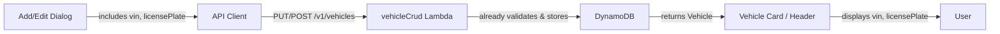
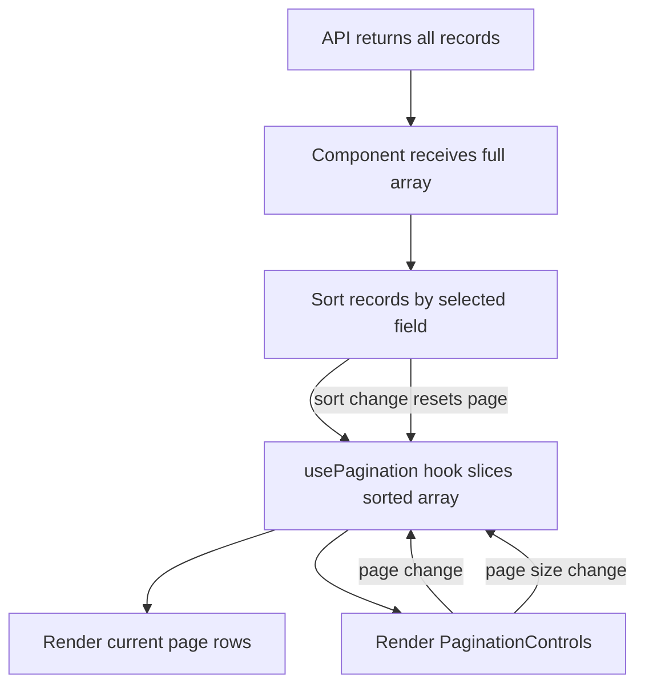

# Design Document: Vehicle Fields and Pagination

## Overview

This design covers two enhancements to PawsitiveMileage:

1. **VIN & License Plate UI surfacing** — The backend already stores `vin` and `licensePlate` on the Vehicle model with validation (VIN max 17 chars, license plate max 20 chars). The gap is purely in the frontend: the Add Vehicle dialog, Edit Vehicle dialog, Vehicle Card (garage), and Vehicle Header Card (detail page) do not expose these fields. This enhancement adds input fields to both dialogs and displays the values on cards.

2. **Client-side pagination for record lists** — The FillupList and MaintenanceList components currently render all records in a single scrollable table. For vehicles with many records, this creates poor UX on both desktop and mobile. This enhancement adds a reusable pagination hook and UI controls (page size selector + prev/next navigation) to both list components. Pagination is client-side since the API already returns all records for a vehicle and the dataset sizes (typically < 1,000 records per vehicle) don't warrant server-side pagination.

## Architecture

Both features are frontend-only changes. No backend or infrastructure modifications are needed.

### VIN & License Plate Flow



The backend `createVehicle` and `updateVehicle` handlers already accept, validate, and persist `vin` (max 17 chars) and `licensePlate` (max 20 chars). The frontend types (`web/src/types/vehicle.ts`) already include these optional fields. Only UI components need changes.

### Pagination Flow



Pagination is implemented as a custom React hook (`usePagination`) that accepts a sorted array and returns the current page slice plus control functions. A shared `PaginationControls` component renders the page size selector and prev/next buttons.

## Components and Interfaces

### Modified Components

#### 1. `AddVehicleDialog` (in `web/src/pages/GaragePage.tsx`)
- Add two optional `<Input>` fields: VIN (maxLength 17) and License Plate (maxLength 20)
- Include `vin` and `licensePlate` in the `createVehicle.mutateAsync()` payload

#### 2. `EditVehicleDialog` (in `web/src/pages/VehicleDetailPage.tsx`)
- Add two optional `<Input>` fields: VIN (maxLength 17, defaultValue from vehicle) and License Plate (maxLength 20, defaultValue from vehicle)
- Include `vin` and `licensePlate` in the `updateVehicle.mutate()` payload

#### 3. `VehicleCard` (in `web/src/components/VehicleCard.tsx`)
- Below the year/make/model `<p>`, conditionally render VIN and/or license plate
- Use a compact layout: small text, muted foreground color, truncated

#### 4. Vehicle Header Card (in `web/src/pages/VehicleDetailPage.tsx`)
- Below the year/make/model `<p>` in the header card, conditionally render VIN and license plate
- Use muted text styling consistent with the existing year/make/model line

#### 5. `FillupList` (in `web/src/components/FillupList.tsx`)
- Integrate `usePagination` hook after sorting
- Render only the current page slice in the table body
- Add `PaginationControls` below the table
- Reset to page 1 when sort changes

#### 6. `MaintenanceList` (in `web/src/components/MaintenanceList.tsx`)
- Same pagination integration as FillupList

### New Components

#### 7. `usePagination` hook (in `web/src/lib/use-pagination.ts`)

```typescript
interface UsePaginationOptions {
  defaultPageSize?: number;  // defaults to 10
}

interface UsePaginationResult<T> {
  pageItems: T[];           // sliced items for current page
  currentPage: number;      // 1-indexed
  totalPages: number;
  pageSize: number;
  setPage: (page: number) => void;
  setPageSize: (size: number) => void;
  resetPage: () => void;    // resets to page 1
}

function usePagination<T>(items: T[], options?: UsePaginationOptions): UsePaginationResult<T>;
```

- Computes `totalPages = Math.ceil(items.length / pageSize)`
- Clamps `currentPage` to valid range when items or pageSize change
- `setPageSize` resets to page 1
- Memoizes `pageItems` slice to avoid unnecessary re-renders

#### 8. `PaginationControls` component (in `web/src/components/PaginationControls.tsx`)

```typescript
interface PaginationControlsProps {
  currentPage: number;
  totalPages: number;
  pageSize: number;
  onPageChange: (page: number) => void;
  onPageSizeChange: (size: number) => void;
  pageSizeOptions?: number[];  // defaults to [10, 20, 50, 100]
}
```

- Renders a row with: page size `<Select>` on the left, "Page X of Y" text in the center, prev/next `<Button>` on the right
- Previous button disabled when `currentPage === 1`
- Next button disabled when `currentPage === totalPages`
- Uses shadcn/ui `Select` and `Button` components
- Hidden entirely when `totalPages <= 1` (fewer records than page size)

### `useUpdateVehicle` mutation (in `web/src/api/vehicles.ts`)

Check that the existing mutation forwards all body fields to the API. Currently the `EditVehicleDialog` only sends `{ nickname, make, model, year, photoKey }`. The mutation itself likely passes through whatever object it receives, but the dialog's `handleSubmit` needs to include the new fields.

## Data Models

No data model changes are required. The existing models already support both features:

### Vehicle (existing — no changes)
```typescript
interface Vehicle {
  userId: string;
  vehicleId: string;
  nickname: string;
  make: string;
  model: string;
  year: number;
  trim?: string;
  color?: string;
  vin?: string;           // already exists, max 17 chars
  licensePlate?: string;  // already exists, max 20 chars
  tankSize?: number;
  fuelType?: string;
  photoKey?: string;
  isArchived: boolean;
  maintenanceOverrides?: Record<string, MaintenanceOverride>;
  createdAt: string;
  updatedAt: string;
}
```

### Pagination State (new, in-memory only)
```typescript
// Managed by usePagination hook — no persistence needed
{
  currentPage: number;  // 1-indexed, defaults to 1
  pageSize: number;     // defaults to 10, options: 10, 20, 50, 100
}
```


## Correctness Properties

*A property is a characteristic or behavior that should hold true across all valid executions of a system — essentially, a formal statement about what the system should do. Properties serve as the bridge between human-readable specifications and machine-verifiable correctness guarantees.*

The VIN/license plate feature (Requirements 1–3) is primarily UI rendering and form integration work. The acceptance criteria are best validated through example-based component tests rather than property-based tests, since they test specific UI states (field present, field pre-populated, field absent).

The pagination feature (Requirements 4–5) centers on the `usePagination` hook, which is a pure function of its inputs (items array, page size, current page). This is an ideal candidate for property-based testing since the properties must hold for all possible list lengths, page sizes, and page numbers.

After prework analysis and redundancy reflection, the following consolidated properties cover all testable pagination criteria:

### Property 1: Page slice size is bounded by page size

*For any* array of items and any valid page size (10, 20, 50, 100), the `pageItems` returned by `usePagination` shall contain at most `pageSize` items, and the default page size shall be 10.

**Validates: Requirements 4.1, 5.1**

### Property 2: Changing page size resets to first page

*For any* array of items and any current page, when `setPageSize` is called with a new page size, `currentPage` shall be reset to 1 and `pageItems` shall reflect the first page at the new size.

**Validates: Requirements 4.3, 4.7, 5.3, 5.7**

### Property 3: All items are partitioned across pages without loss or duplication

*For any* array of items and any valid page size, concatenating `pageItems` from page 1 through `totalPages` shall produce an array equal to the original items array (same elements, same order).

**Validates: Requirements 4.1, 4.3, 5.1, 5.3**

### Property 4: Single page when items fit within page size

*For any* array of items where `items.length <= pageSize`, `totalPages` shall be 1.

**Validates: Requirements 4.8, 5.8**

### Property 5: Current page is always within valid bounds

*For any* array of items, any page size, and any sequence of `setPage` calls, `currentPage` shall always satisfy `1 <= currentPage <= totalPages` (or `currentPage === 1` when items is empty).

**Validates: Requirements 4.5, 4.6, 5.5, 5.6**

## Error Handling

### VIN & License Plate

- **Client-side validation**: HTML `maxLength` attribute on VIN (17) and license plate (20) input fields prevents over-length input. No additional error states needed since the fields are optional and the backend already validates.
- **Backend validation**: Already in place — `validateStringLength` in `vehicleCrud.ts` returns `VALIDATION_ERROR` for over-length values. No changes needed.
- **Empty values**: Both fields are optional. Empty strings or omitted fields are valid and result in no display on cards.

### Pagination

- **Empty list**: When `items.length === 0`, `totalPages` is 1, `currentPage` is 1, `pageItems` is `[]`. The existing empty state UI (icon + message) renders as before.
- **Out-of-bounds page**: If items are deleted while on a later page (e.g., user is on page 5 but items shrink to 3 pages), `usePagination` clamps `currentPage` to `totalPages` via a `useEffect`.
- **Invalid page size**: The `Select` component only offers predefined options (10, 20, 50, 100), so invalid page sizes cannot be selected through the UI.

## Testing Strategy

### Unit Tests (example-based)

- **VehicleCard rendering**: Test that VIN and license plate appear when present, and are absent when not set
- **Vehicle Header Card rendering**: Same conditional display tests for the detail page header
- **AddVehicleDialog**: Test that VIN and license plate fields are rendered and included in form submission
- **EditVehicleDialog**: Test that fields are pre-populated with existing values
- **PaginationControls rendering**: Test that controls are hidden when `totalPages <= 1`, prev disabled on page 1, next disabled on last page

### Property-Based Tests (using fast-check)

All five correctness properties above will be implemented as property-based tests against the `usePagination` hook using `fast-check` and `@testing-library/react` `renderHook`.

**Configuration**:
- Library: `fast-check` 4.5.x (already in project dependencies)
- Test runner: Vitest 4.x
- Minimum iterations: 100 per property
- Each test tagged with: `Feature: vehicle-fields-and-pagination, Property N: {title}`

**Generators**:
- `fc.array(fc.anything())` for arbitrary item arrays (pagination doesn't care about item type)
- `fc.constantFrom(10, 20, 50, 100)` for valid page sizes
- `fc.integer({ min: 1, max: 1000 })` for page numbers (clamped by hook)

**Test file**: `web/tests/unit/use-pagination.test.ts`
