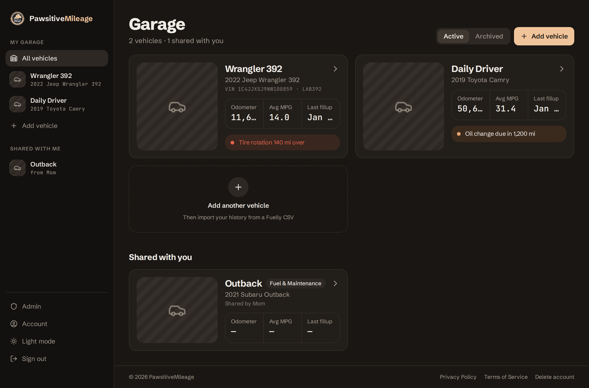
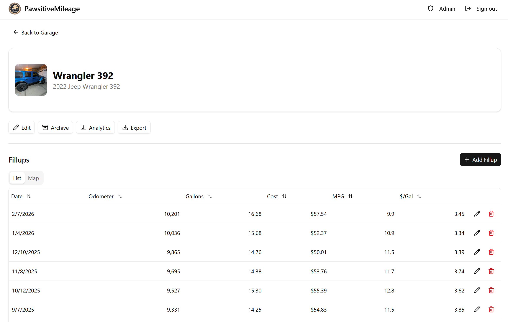
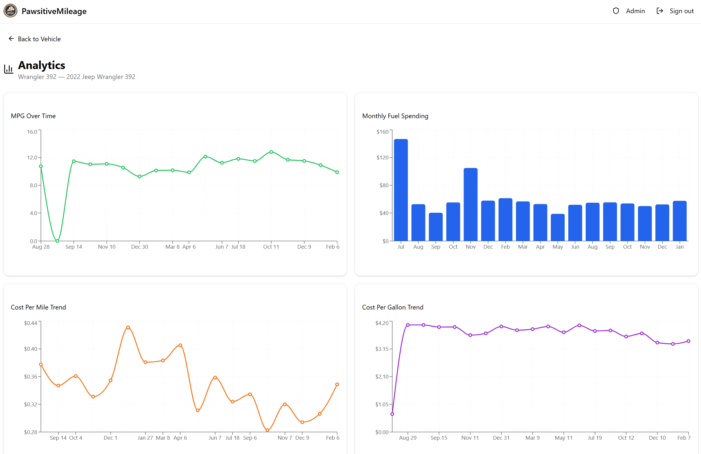
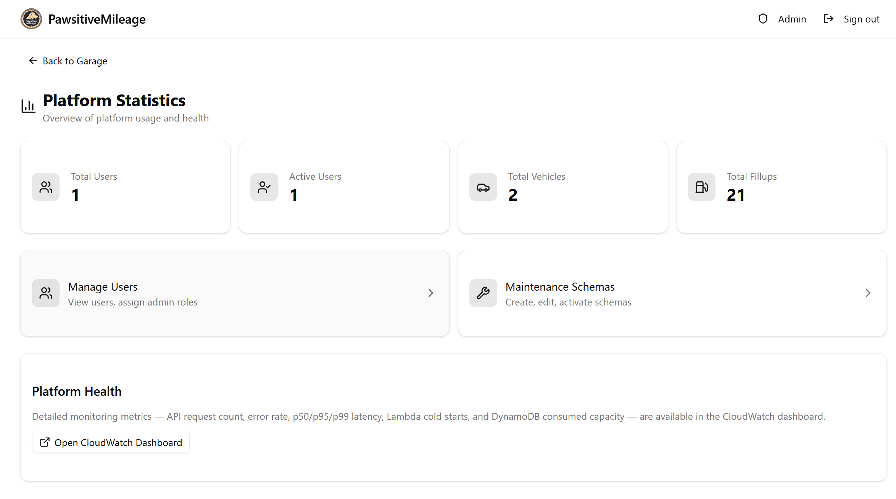
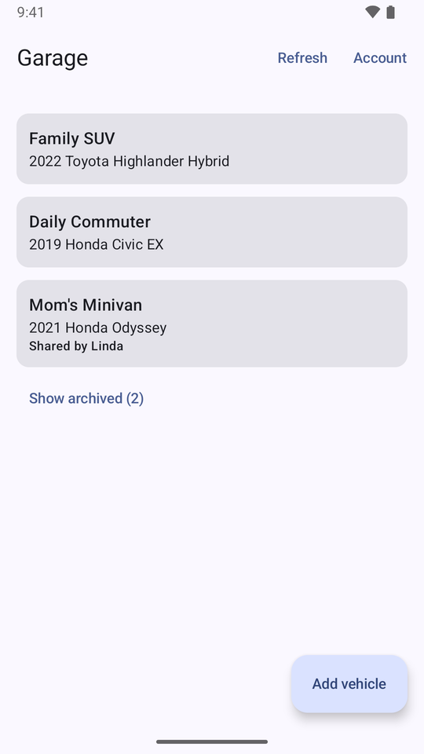
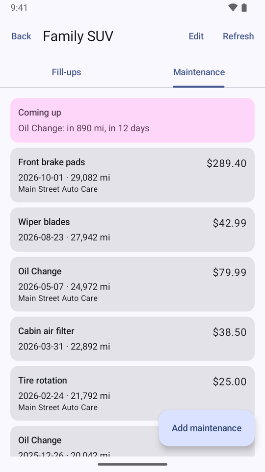
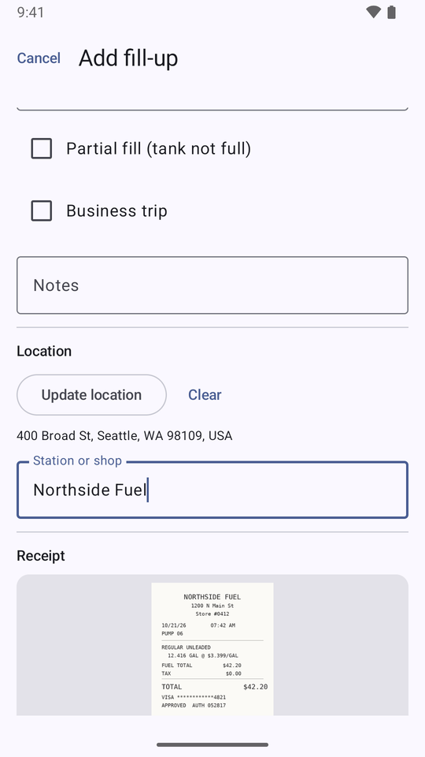

# 🐾 PawsitiveMileage

A serverless vehicle fuel tracking and maintenance management application built on AWS. Users log fuel purchases with minimal input and the system auto-calculates MPG, cost per mile, price per gallon, and miles between fillups.

Live at **[pawsitivemileage.app](https://pawsitivemileage.app)**, with an [Android app](#android-app) and a [command line](#pm-command-line) on the same API. Built with React 19, AWS Lambda (Node.js 24.x), DynamoDB, and CDK — designed to run for under $12/month at 1,000 users.

- **API reference:** [docs/api-reference.md](docs/api-reference.md), generated from the [OpenAPI 3.1 contract](packages/contracts/openapi.json) (or browse it in [Redoc](https://redocly.github.io/redoc/?url=https://raw.githubusercontent.com/bourbonlab/pawsitivemileage/main/packages/contracts/openapi.json))
- **Hosting:** the dedicated AWS account `376784708284`, us-east-1. The app moved there from `*.bourbonlab.net` on 2026-10-21, and the old address redirects ([docs/account-migration.md](docs/account-migration.md))

**License:** [GNU AGPL v3](LICENSE)

---

## Table of Contents

- [Features](#features)
- [Screenshots](#screenshots)
- [Architecture](#architecture)
- [Project Structure](#project-structure)
- [Tech Stack](#tech-stack)
- [Prerequisites](#prerequisites)
- [Getting Started](#getting-started)
- [Environment Variables](#environment-variables)
- [Deployment](#deployment)
- [API Reference](#api-reference)
- [Data Model](#data-model)
- [Authentication](#authentication)
- [Frontend Architecture](#frontend-architecture)
- [Backend Architecture](#backend-architecture)
- [Infrastructure](#infrastructure)
- [Android app](#android-app)
- [pm command line](#pm-command-line)
- [CLI Tools](#cli-tools)
- [Testing](#testing)
- [Monitoring](#monitoring)
- [Cost Estimate](#cost-estimate)
- [Sample Data](#sample-data)
- [Security](#security)
- [License](#license)

---

## Features

**Fuel Tracking**
- Log fillups with date, amount spent, gallons, and odometer reading
- Auto-calculated MPG, cost per mile, price per gallon, miles between fillups
- Partial fill support (defers MPG calculation until next full fill, accumulating gallons and miles)
- Receipt photo uploads via S3 presigned URLs
- Optional location tagging (browser geolocation, map picker via Leaflet, or manual entry)
- Business trip flag per fill-up

**Garage / Multi-Vehicle**
- Add unlimited vehicles with make, model, year, photo, and specs (trim, color, VIN, license plate, tank size, fuel type)
- Archive/unarchive vehicles without losing historical data
- Per-vehicle fillup and maintenance history

**Maintenance Tracking**
- Admin-configurable maintenance schemas (Oil Change, Tire Rotation, etc.) with mileage and time intervals
- Per-vehicle maintenance records with cost, odometer, and receipt photos
- Mileage-based and time-based reminders (500-mile / 30-day thresholds), shown once a maintenance type has a recorded service on the vehicle
- Custom one-off maintenance entries not tied to a schema
- Per-vehicle interval overrides for global schemas

**Analytics & Reporting**
- MPG over time, monthly spending, cost per mile, cost per gallon trend charts (Recharts)
- Year-over-year comparisons with percentage change indicators
- Shareable summary cards (annual vehicle stats)
- CSV export for fillups and maintenance with date range filtering
- PDF report generation

**Data Import & Recalculation**
- Import Fuelly CSV exports (fuelups and maintenance) via S3 presigned upload
- CSV parsing with field mapping, validation, and skip logic for invalid rows
- Fillup and maintenance imports allow multiple entries per day (no duplicate filtering)
- Bulk metrics recalculation for all fillups on a vehicle
- Import result summary (imported, skipped, errors)

**Vehicle Sharing**
- Share vehicles with other users by email address
- Three permission levels: Read Only, Fuel & Maintenance (add/edit/delete fillups and maintenance records), and Full Access (also CSV import and metric recalculation). Legacy maintenance-only shares behave like Fuel & Maintenance
- Records created or edited by shared users are attributed to the vehicle owner
- Shared vehicles appear in a dedicated "Shared Garage" section on the Garage page
- Permission-based UI controls — edit/delete buttons hidden based on access level
- Email-based sharing without registration check (prevents user enumeration)
- Owner-only sharing management dialog with add, update, and revoke controls

**Clients**
- Responsive web app with light and dark themes
- [Android app](#android-app): garage, fill-ups and maintenance with offline entry, receipts from the camera, GPS location, shared vehicles
- [`pm`](#pm-command-line), a command line for logging fill-ups and maintenance and exporting data
- All three use one [API contract](docs/api-contract.md): safe retries (`Idempotency-Key`), conflict detection (`If-Match`), and pagination

**Account**
- Account page (header → **Account**, and in the Android app) shows who's signed in and deletes the account and all its data, including the sign-in
- Public [`/delete-account`](https://pawsitivemileage.app/delete-account) page explaining deletion (Google Play's account-deletion URL)

**Admin Panel**
- User management with admin role assignment
- Maintenance schema CRUD with activate/deactivate
- Platform-wide statistics (total users, vehicles, fillups, maintenance records)
- CloudWatch monitoring dashboard

**Auth**
- Google OAuth 2.0 via AWS Cognito Hosted UI
- JWT-based API authorization (API Gateway v2 JWT authorizer)
- Role-based access control (user vs admin, admin flag stored in DynamoDB)

---

## Screenshots

### Garage


### Fillups


### Analytics


### Admin Dashboard


### Android
  

---

## Architecture

```
   Web app · Android app · pm CLI
                 │
                 ▼
┌──────────────┐     ┌──────────────┐     ┌─────────────────┐
│  CloudFlare  │────▶│  CloudFront  │────▶│  S3 (Frontend)  │
│ (DNS/Proxy)  │     │  (CDN/TLS)   │     │  SPA + APK      │
└──────────────┘     └──────────────┘     └─────────────────┘
       │                    │ /photos/*
       │                    └─────────────────────────────────┐
       │             ┌──────────────┐     ┌─────────────────┐ │
       └────────────▶│ API Gateway  │────▶│  Lambda (×13)   │ │
                     │ HTTP API v2  │     │  Node.js 24.x   │ │
                     │ JWT Auth     │     └────────┬────────┘ │
                     └──────────────┘              │          │
                                                   ▼          │
                     ┌──────────────┐     ┌─────────────────┐ │
                     │   Cognito    │     │  DynamoDB (×7)  │ │
                     │  User Pool   │     │  On-Demand      │ │
                     │  Google IdP  │     │  + GSIs + PITR  │ │
                     └──────────────┘     └─────────────────┘ │
                                                   │          │
                                          ┌────────┴───────┐  │
                                          ▼                ▼  ▼
                                   ┌────────────┐   ┌────────────┐
                                   │S3 (Exports)│   │ S3 (Photos)│
                                   │ 7-day TTL  │   │ Presigned  │
                                   └────────────┘   └────────────┘
```

All infrastructure is serverless — zero cost when idle, scales automatically. DNS is managed in CloudFlare with proxy enabled (Full Strict SSL mode). An ACM certificate in us-east-1 covering `pawsitivemileage.app` and `*.pawsitivemileage.app` provides TLS for CloudFront, API Gateway and the Cognito Hosted UI.

The web app signs in through the Cognito Hosted UI with Google and sends ID tokens. The Android app and `pm` are public PKCE clients of the same user pool: they read the sign-in settings from `GET /v1/meta` and send access tokens. Everything runs in the dedicated AWS account `376784708284`; staging and production are separate stacks in that account.

| | Production | Staging |
|---|---|---|
| Web | https://pawsitivemileage.app | https://staging.pawsitivemileage.app |
| API | https://api.pawsitivemileage.app | https://api-staging.pawsitivemileage.app |
| Sign-in (Hosted UI) | `auth.pawsitivemileage.app` | `auth-staging.pawsitivemileage.app` |
| Android package | `app.pawsitivemileage` | `app.pawsitivemileage.staging` |

`pawsitivemileage.bourbonlab.net`, the address before the 2026-10-21 move, redirects to https://pawsitivemileage.app.

---

## Project Structure

```
pawsitivemileage/
├── packages/
│   ├── contracts/          # API contract: zod schemas + route table for every /v1 route (docs/api-contract.md)
│   │   ├── src/            # entities, requests, responses, routes, openapi (document builder)
│   │   ├── scripts/        # write-openapi.ts (npm run openapi)
│   │   ├── tests/          # request rules, responses, route table vs api-stack.ts, openapi.json + api-reference.md freshness
│   │   └── openapi.json    # Generated OpenAPI 3.1 document, committed (docs/api-reference.md is built from it)
│   └── sdk/                # Typed TypeScript client built from the contract (web + pm)
│
├── web/                    # React frontend (Vite + TypeScript)
│   ├── src/
│   │   ├── api/            # React Query hooks over the SDK
│   │   │   ├── client.ts   # `api`: the @pawsitivemileage/sdk client with the Amplify ID token
│   │   │   ├── vehicles.ts, fillups.ts, maintenance.ts, analytics.ts
│   │   │   ├── upload.ts   # Presigned URL upload (photos + CSV import)
│   │   │   ├── import.ts   # CSV import + metrics recalculation mutations
│   │   │   ├── sharing.ts  # Vehicle sharing CRUD + shared vehicles query
│   │   │   └── admin.ts    # Admin API calls
│   │   ├── auth/           # Amplify config, AuthProvider, ProtectedRoute, AdminRoute
│   │   ├── components/     # UI components
│   │   │   ├── Layout.tsx          # App shell: nav (incl. Account), theme toggle, footer links
│   │   │   ├── AppVersion.tsx      # Footer release version (/version.json) and Android APK link (/downloads/android.json)
│   │   │   ├── VehicleCard.tsx, FillupList.tsx, MaintenanceList.tsx, DetailPeekDialog.tsx
│   │   │   ├── FillupMap.tsx, LocationPicker.tsx  # Leaflet map and location picker
│   │   │   ├── ReminderBanner.tsx  # Upcoming maintenance alerts
│   │   │   ├── SummaryCard.tsx     # Shareable annual stats card
│   │   │   ├── PhotoUpload.tsx     # S3 presigned URL photo upload
│   │   │   ├── ImportDialog.tsx    # Fuelly CSV import dialog
│   │   │   ├── PaginationControls.tsx
│   │   │   ├── SharedGarageSection.tsx, SharingManagementDialog.tsx
│   │   │   ├── charts/             # Recharts: MPG, spending, cost per mile, cost per gallon
│   │   │   └── ui/                 # shadcn/ui primitives (Radix-based)
│   │   ├── lib/            # metrics formatting, photo URLs, sharing permissions, pagination, theme, cn()
│   │   ├── pages/          # Route pages (see Frontend Architecture → Pages)
│   │   ├── App.tsx         # Root: QueryClientProvider + AuthProvider + RouterProvider
│   │   ├── router.tsx      # React Router route definitions
│   │   ├── main.tsx        # Entry point (configureAmplify → render)
│   │   └── app.css         # Global styles (Tailwind CSS v4)
│   ├── public/             # Static assets (logo)
│   └── tests/              # Vitest unit + component tests
│
├── api/                    # Lambda handlers (Node.js 24.x + esbuild)
│   ├── src/
│   │   ├── handlers/       # One handler per route group (13): userProfile, vehicleCrud, fillupCrud,
│   │   │                   # maintenanceCrud, analytics, exportData, importData, presignUrl,
│   │   │                   # sharingCrud, adminUsers, adminSchemas, adminStats, meta
│   │   ├── lib/            # Shared utilities (see Backend Architecture → Shared Libraries)
│   │   └── types/          # Internal TypeScript types (API types come from the contract)
│   └── tests/unit/         # API unit + property-based tests
│
├── infra/                  # AWS CDK infrastructure-as-code
│   ├── bin/app.ts          # CDK app entry point (stack wiring + dependency ordering)
│   ├── bin/github-access.ts # Separate CDK app: GitHub OIDC provider + deploy roles (deployed by hand)
│   ├── lib/
│   │   ├── config.ts       # Environment configs (test, staging, production) with context overrides
│   │   ├── client-metadata.ts # GET /v1/meta values: minimum client versions, feature flags, native redirect URIs
│   │   ├── tags.ts         # Resource tagging utility (Environment, Project, ManagedBy)
│   │   ├── constructs/lambda-function.ts  # AppFunction construct (NodejsFunction + LogGroup + X-Ray)
│   │   └── stacks/
│   │       ├── auth-stack.ts       # Cognito User Pool, Google IdP, web/Android/CLI app clients, Hosted UI domain
│   │       ├── database-stack.ts   # 7 DynamoDB tables (6 with PITR) + 6 GSIs
│   │       ├── storage-stack.ts    # S3 buckets (Photos, Exports with 7-day lifecycle)
│   │       ├── api-stack.ts        # API Gateway v2, 13 Lambda functions, JWT authorizer, 40 routes
│   │       ├── frontend-stack.ts   # S3 + CloudFront with OAC, /photos behavior, security headers
│   │       ├── monitoring-stack.ts # Optional CloudWatch dashboard (not deployed by default)
│   │       └── github-access-stack.ts # GitHub Actions OIDC provider + per-environment deploy roles
│   └── test/               # Stack synthesis, Cognito auth config, GitHub access tests
│
├── android/                # Android app (Kotlin, Compose); API client generated from openapi.json (android/README.md)
│
├── pm/                     # pm: the user-facing command line, on the SDK (see "pm command line")
│   ├── src/
│   │   ├── main.ts              # Command dispatch, login/logout, error reporting
│   │   ├── commands.ts          # whoami, vehicles, fillups, fillup add, maintenance (add), reminders, export
│   │   ├── auth.ts              # PKCE sign-in through the Hosted UI, loopback redirect, token refresh/revoke
│   │   └── session.ts           # Per-environment sessions in ~/.config/pawsitivemileage (0600)
│   └── tests/
│
├── cli/                    # Admin CLI tools (run with npx tsx; see CLI Tools)
│   ├── src/
│   │   ├── migrate-account.ts   # Account migration, cutover and lock (done 2026-10-21)
│   │   ├── parity-check.ts      # Post-migration parity + write smoke tests via direct Lambda invocation
│   │   ├── contract-check.ts    # Live check: every read endpoint's response vs packages/contracts
│   │   ├── relocate-files.ts    # Move files stored under a non-owner's ID to the vehicle owner
│   │   ├── backfill-gsi2.ts, backfill-is-business.ts # One-off fill-up backfills
│   │   ├── release/version.ts   # Semantic version from conventional commits (used by GitHub Actions)
│   │   └── migrate/, contract/, relocate/ # Unit-tested helpers for the scripts above
│   └── tests/                   # Vitest unit tests
│
├── SampleData/
│   └── FuelEfficency.csv   # 19 real-world fillup records (Aug 2024 – Feb 2026)
│
├── docs/
│   ├── api-reference.md    # Every endpoint and schema, generated from openapi.json
│   ├── api-contract.md     # How the contract, SDK and generated clients fit together; changing an endpoint
│   ├── tools/api-reference.mjs # Generates api-reference.md
│   ├── account-migration.md # Account migration, cutover log, and legacy teardown runbook
│   ├── ci-cd.md            # GitHub Actions pipelines, versioning, OIDC deploy roles, APK publishing
│   ├── security.md         # Security assessment with remediation status
│   ├── cost.md             # Detailed AWS cost estimate breakdown
│   ├── code-review-2026-05.md # May 2026 code review findings (snapshot)
│   └── *.png               # README screenshots
│
├── .github/workflows/      # CI, PR title, Deploy (main → staging → production), Android — see docs/ci-cd.md
├── .claude/settings.json   # Shared Claude Code project settings
├── CLAUDE.md               # Project conventions for AI assistants (accounts, workflow, commands)
│
├── deploy.sh               # Full CI/CD pipeline script (run locally and by GitHub Actions)
├── setup-github.sh         # Copy .env config into the GitHub staging/production environments
├── unit-test.sh            # Run the API + frontend test suites
├── package.json            # npm workspaces root (build/test/lint/audit scripts)
├── .nvmrc                  # Node.js version (24), used by GitHub Actions
├── Project.md              # Original project charter and specification
├── Roadmap.md              # Planned features
├── StartingPrompt          # Original project prompt
├── tsconfig.base.json      # Shared TypeScript config (ES2022, strict, bundler resolution)
├── .env.example            # Environment variable template
└── LICENSE                 # GNU AGPL v3
```

---

## Tech Stack

| Layer | Technology | Version | Notes |
|-------|-----------|---------|-------|
| Frontend | React | 19.3.x | With TypeScript |
| Build | Vite | 8.3.x | Fast HMR, Tailwind CSS plugin |
| Routing | React Router | v8.5.x | `createBrowserRouter` with element-based routes |
| Server State | TanStack Query | v5.104.x | 5-min stale time, single retry |
| UI Components | shadcn/ui + Radix | v4 | Mobile-first, Tailwind CSS v4 |
| Charts | Recharts | 3.10.x | MPG, spending, cost per mile, cost per gallon |
| Maps | Leaflet + react-leaflet | 1.9.x / 5.x | Fillup location picker and map view |
| Icons | Lucide React | 1.60.x | |
| Styling | Tailwind CSS | 4.3.x | With tailwind-merge + clsx via `cn()` |
| Auth (client) | AWS Amplify JS | v6.22.x | Cognito OAuth, token management |
| Backend Runtime | Node.js on Lambda | 24.x | Latest LTS |
| Bundler (Lambda) | esbuild (via CDK NodejsFunction) | 0.28.x | ESM output, tree-shaking, minified, source maps |
| Database | DynamoDB | On-demand | 7 tables, 6 GSIs; PITR on all but the idempotency cache |
| Object Storage | S3 | — | 3 buckets (frontend, photos, exports) |
| CDN | CloudFront | — | OAC, TLS 1.2, SPA error handling |
| Auth | Cognito | — | Google OAuth 2.0, Hosted UI on custom domain (`auth.pawsitivemileage.app`) |
| API | API Gateway v2 | HTTP API | JWT authorizer, CORS, custom domain |
| API contract | zod | 4.6.x | Schemas + route table in `packages/contracts`; OpenAPI 3.1 generated from them |
| Infrastructure | AWS CDK | 2.273.x (CLI 2.1146) | 5 stacks per environment (+ optional monitoring), TypeScript |
| Language | TypeScript | 7.0.x | Strict mode, ES2022 target |
| Testing | Vitest | 5.x | Unit + property-based (fast-check 4.x) |
| IDs | ULID | 3.x | Sortable unique IDs for fillups, vehicles, etc. |
| DNS | CloudFlare | — | Proxied, Full Strict SSL |
| Android | Kotlin + Jetpack Compose | Kotlin 2.2, AGP 8.13, SDK 36 (min 26) | AppAuth, Retrofit (generated), Room, WorkManager, Coil |

---

## Prerequisites

- **Node.js** 24+ ([nodejs.org](https://nodejs.org/))
- **npm** (comes with Node.js)
- **AWS CLI** v2 ([install guide](https://docs.aws.amazon.com/cli/latest/userguide/install-cliv2.html))
- **AWS CDK CLI** (installed as a devDependency in `infra/`; no global install needed)
- **AWS credentials** for the app's dedicated account (an `AWS_PROFILE` set in `.env`, e.g. IAM Identity Center via `aws sso login`)
- **CDK bootstrap** in that account, once: `npx cdk bootstrap aws://<account-id>/us-east-1` (run outside `infra/`)
- **Google OAuth credentials** (Client ID + Secret for Cognito identity provider)
- **ACM certificate** in **us-east-1** covering the apex and wildcard (e.g. `pawsitivemileage.app` + `*.pawsitivemileage.app`) — used by CloudFront, API Gateway, and the Cognito custom domain
- For the Android app only: **JDK 17** and the **Android SDK** (platform 36), e.g. through Android Studio ([android/README.md](android/README.md))

---

## Getting Started

### 1. Clone and install

```bash
git clone https://github.com/bourbonlab/pawsitivemileage.git
cd pawsitivemileage

# Install all workspaces (packages/*, api, web, cli, pm, infra) from the root lockfile
npm ci
```

### 2. Configure environment

```bash
cp .env.example .env
# Edit .env with your AWS profile/account IDs, Google OAuth Client ID, ACM certificate ARN, and domain names
```

See [Environment Variables](#environment-variables) for the full list of required values.

### 3. Store Google OAuth secret in Secrets Manager

The Google OAuth client secret must be stored in AWS Secrets Manager — it is never passed as plaintext through CDK context or CLI arguments. The CDK Auth stack reads it at deploy time via `cdk.SecretValue.secretsManager()`.

```bash
# Create the secret (use your actual Google client secret value)
aws secretsmanager create-secret \
  --name pawsitivemileage/google-oauth-client-secret \
  --description "Google OAuth client secret for PawsitiveMileage Cognito integration" \
  --secret-string "YOUR_GOOGLE_CLIENT_SECRET" \
  --region us-east-1 --profile pawsitivemileage
```

Copy the full ARN from the output (e.g. `arn:aws:secretsmanager:us-east-1:123456789:secret:pawsitivemileage/google-oauth-client-secret-AbCdEf`) and set it in `.env`:

```env
# Both can point to the same secret, or use separate secrets per environment
GOOGLE_CLIENT_SECRET_ARN_STAGING=arn:aws:secretsmanager:us-east-1:123456789:secret:pawsitivemileage/google-oauth-client-secret-AbCdEf
GOOGLE_CLIENT_SECRET_ARN_PRODUCTION=arn:aws:secretsmanager:us-east-1:123456789:secret:pawsitivemileage/google-oauth-client-secret-AbCdEf
```

To update the secret value later:

```bash
aws secretsmanager put-secret-value \
  --secret-id pawsitivemileage/google-oauth-client-secret \
  --secret-string "NEW_SECRET_VALUE" \
  --region us-east-1
```

### 4. Deploy infrastructure (first time)

```bash
./deploy.sh --stage   # Full pipeline: install → build → test → synth → deploy
```

The deploy script automatically fetches Cognito outputs after deployment and builds the frontend with the correct `VITE_*` environment variables baked in.

### 5. Local frontend development

After your first deployment, create `web/.env.local` with the Cognito values from CDK stack outputs:

```env
VITE_API_URL=https://api-staging.pawsitivemileage.app
VITE_COGNITO_USER_POOL_ID=us-east-1_XXXXXXXXX
VITE_COGNITO_APP_CLIENT_ID=xxxxxxxxxxxxxxxxxxxxxxxxxx
VITE_COGNITO_DOMAIN=auth-staging.pawsitivemileage.app
```

Then run the dev server:

```bash
cd web && npm run dev
# → http://localhost:5173
```

API calls go to the deployed staging environment. The Cognito app client includes `http://localhost:5173` in its callback URLs for non-production environments.

### 6. Build and test API locally

```bash
cd api && npm run build    # esbuild bundle → api/dist/
cd api && npm test         # vitest run
```

---

## Environment Variables

### Deployment (`.env` at project root)

All deployment configuration lives in a single `.env` file. The `deploy.sh` script validates that every required variable is present and not a placeholder before running.

| Variable | Description | Example |
|----------|-------------|---------|
| `GOOGLE_CLIENT_ID` | Google OAuth 2.0 Client ID | `123456789-abc.apps.googleusercontent.com` |
| `AWS_PROFILE` | AWS CLI profile used for every `aws`/`cdk` call | `pawsitivemileage` |
| `AWS_ACCOUNT_ID_STAGING` / `_PRODUCTION` | Account each environment is pinned to — deploy aborts if credentials don't match | `376784708284` |
| `GOOGLE_CLIENT_SECRET_ARN_STAGING` / `_PRODUCTION` | Secrets Manager ARN for the Google OAuth secret (in the target account) | `arn:aws:secretsmanager:us-east-1:123456789012:secret:my-secret-AbCdEf` |
| `ACM_CERTIFICATE_ARN` | ACM certificate ARN (**must be us-east-1**) | `arn:aws:acm:us-east-1:...` |
| `FRONTEND_DOMAIN_STAGING` / `_PRODUCTION` | Frontend domain | `staging.pawsitivemileage.app` / `pawsitivemileage.app` |
| `API_DOMAIN_STAGING` / `_PRODUCTION` | API domain | `api-staging.pawsitivemileage.app` / `api.pawsitivemileage.app` |
| `AUTH_DOMAIN_STAGING` / `_PRODUCTION` | Cognito Hosted UI custom domain | `auth-staging.pawsitivemileage.app` / `auth.pawsitivemileage.app` |
| `RESOURCE_PREFIX` | Prefix for AWS resource names (S3 bucket names are globally unique) | `pawsitivemileage-app` |
| `SOURCE_CODE_URL` | Source code repository URL (leave blank to hide the link) | `https://github.com/org/PawsitiveMileage` |
| `SUPPORT_EMAIL` | Support email shown on Privacy Policy and Terms of Service pages | `support@example.com` |

The `.env` file is in `.gitignore` and should never be committed. Only the target environment's `*_<ENV>` variables are required. A `--test` environment is still supported by the code; add `*_TEST` variables to use it.

### Frontend (`web/.env.local`)

| Variable | Description |
|----------|-------------|
| `VITE_API_URL` | API Gateway endpoint URL (e.g. `https://api-staging.pawsitivemileage.app`) |
| `VITE_COGNITO_USER_POOL_ID` | Cognito User Pool ID |
| `VITE_COGNITO_APP_CLIENT_ID` | Cognito App Client ID |
| `VITE_COGNITO_DOMAIN` | Cognito Hosted UI custom domain (e.g. `auth-staging.pawsitivemileage.app`) |
| `VITE_SOURCE_CODE_URL` | Source code repository URL (optional; hides link if blank) |
| `VITE_SUPPORT_EMAIL` | Support email shown on Privacy Policy and Terms of Service pages |

The Cognito values come from CDK stack outputs after deployment. The branding values (`VITE_SOURCE_CODE_URL`, `VITE_SUPPORT_EMAIL`) are passed through from the root `.env` file by `deploy.sh`. The deploy script automatically injects them during the frontend build step.

The footer's release version isn't a build variable: `deploy.sh` writes it to `version.json` beside the build (the release tag in GitHub Actions, `APP_VERSION`, else `git describe`), and the app fetches it at runtime. It is hidden in local dev, where the file doesn't exist.

### Lambda (set automatically by CDK)

| Variable | Description |
|----------|-------------|
| `USERS_TABLE` | DynamoDB Users table name |
| `VEHICLES_TABLE` | DynamoDB Vehicles table name |
| `FILLUPS_TABLE` | DynamoDB Fillups table name |
| `MAINTENANCE_TABLE` | DynamoDB Maintenance table name |
| `SCHEMAS_TABLE` | DynamoDB Schemas table name |
| `SHARING_TABLE` | DynamoDB Sharing table name |
| `IDEMPOTENCY_TABLE` | DynamoDB idempotency records (24-hour TTL) |
| `PHOTOS_BUCKET` | S3 photos bucket name |
| `EXPORTS_BUCKET` | S3 exports bucket name |
| `FRONTEND_DOMAIN` | Frontend domain (for CORS headers) |
| `ENVIRONMENT` | Current environment name (test/staging/production) |
| `NODE_OPTIONS` | `--enable-source-maps` (set by AppFunction construct) |
| `AUTH_DOMAIN`, `USER_POOL_ID` | `userProfile` only: reads `/oauth2/userInfo` for access tokens, and deletes the Cognito user with the account |
| `MIN_CLIENT_VERSIONS`, `FEATURE_FLAGS`, `AUTH_CONFIG` | `meta` only: the `GET /v1/meta` values from `infra/lib/client-metadata.ts` and the auth stack |

---

## Deployment

### GitHub Actions

Pull requests run lint, all tests, the build and a CDK synth ([`ci.yml`](.github/workflows/ci.yml)), plus a PR title check ([`pr-title.yml`](.github/workflows/pr-title.yml)). Every push to `main` that changes more than docs deploys **staging**, then **production** once approved in the `production` GitHub environment ([`deploy.yml`](.github/workflows/deploy.yml)). Deploy jobs reach AWS through GitHub OIDC with a per-environment role; there are no AWS keys in GitHub. Production deploys also build and sign the Android APK and publish it on the site. The **Android** workflow ([`android.yml`](.github/workflows/android.yml)) tests and builds the app on PRs that touch it. Setup, configuration and access details are in [docs/ci-cd.md](docs/ci-cd.md).

Every deploying merge to `main` is a release: it is tagged `vX.Y.Z` with the next [semantic version](https://semver.org) from its conventional commits (`feat` → minor, `!`/`BREAKING CHANGE` → major, anything else → patch), gets a GitHub Release, and shows that version in the app footer. PR titles must be conventional commits; a check shows the version merging will release. Docs-only merges (`*.md`, `docs/`, `LICENSE`, `.claude/`) don't deploy and ship with the next release. See [Versioning](docs/ci-cd.md#versioning).

**Workflow:** branch from `main` (`feat/`, `fix/`, `refactor/`, `chore/`, `docs/`), open a PR, and merge it once CI is green. The merge deploys staging automatically; check the change there, and fix any issue in a follow-up PR. Production deploys only after a reviewer approves the run in the `production` environment.

```bash
git push -u origin fix/short-description
gh pr create --title "fix: short description" --base main
gh pr merge <number> --merge --delete-branch
```

### Deploy Script (`deploy.sh`)

The `deploy.sh` script handles the full CI/CD pipeline:

```bash
./deploy.sh              # Install, build, test, synth only (no deploy)
./deploy.sh --stage      # Deploy to staging environment
./deploy.sh --prod --yes # Deploy to production (--yes required as safety gate)

# Options
./deploy.sh --skip-tests # Skip running test suites
./deploy.sh --verbose    # Show detailed command output
./deploy.sh --stage --clear-cache  # Only purge CloudFront + CloudFlare caches (no build or deploy)
```

**Pipeline steps:**

1. Prerequisite checks (Node.js 24+, npm, AWS CLI, CDK)
2. AWS credential verification (`sts get-caller-identity`) — aborts if the account doesn't match `AWS_ACCOUNT_ID_<ENV>`
3. Load and validate `.env` (all required variables present, no placeholders). In GitHub Actions (`CI=true`) there is no `.env`: the same variables come from the GitHub environment, unsuffixed
4. `npm ci` at the repo root (all workspaces), then `npm audit --audit-level=high`
5. API build (esbuild → `api/dist/`)
6. API tests (vitest, skippable with `--skip-tests`)
7. CDK synth with environment context variables (per-environment secret ARN, domains)
8. CDK deploy all stacks (if environment flag provided; `--require-approval never`, so IAM changes are reviewed in PRs). Unchanged stacks are skipped, and independent stacks deploy in parallel
9. Fetch Cognito outputs from CloudFormation stack
10. Build frontend with `VITE_*` env vars baked in, and write the release version to `web/dist/version.json`
11. Upload only the files that differ from the frontend bucket (by MD5), `index.html` last. A build with an Android APK (production in CI) uploads it under `downloads/` before `downloads/android.json`; a build without one leaves the published APK in place
12. Purge CloudFront and Cloudflare only if something changed: everything if `index.html` changed, else just the changed fixed-name files

See [What a deploy changes](docs/ci-cd.md#what-a-deploy-changes).

### Environments

| Environment | Deploy Flag | CDK Context | Stack Prefix |
|-------------|-------------|-------------|--------------|
| staging | `--stage` | `-c environment=staging` | `PawsitiveMileage-staging-` |
| production | `--prod --yes` | `-c environment=production` | `PawsitiveMileage-production-` |

Both environments live in the dedicated PawsitiveMileage AWS account (`376784708284`, us-east-1); every stack is pinned to it via `-c account`. Each environment gets its own set of stacks, DynamoDB tables, S3 buckets, Cognito user pool, and API Gateway. Resource names are prefixed with `{RESOURCE_PREFIX}-{environment}`.

### CDK Context Variables

The deploy script passes all configuration to CDK via context flags:

```bash
npx cdk deploy --all \
  -c environment=staging \
  -c account=376784708284 \
  -c googleClientId="..." \
  -c googleClientSecretArn="arn:aws:secretsmanager:..." \
  -c apiCertificateArn="..." \
  -c frontendCertificateArn="..." \
  -c authCertificateArn="..." \
  -c frontendDomain="staging.pawsitivemileage.app" \
  -c apiDomain="api-staging.pawsitivemileage.app" \
  -c authDomain="auth-staging.pawsitivemileage.app" \
  -c resourcePrefix="pawsitivemileage-app-staging"
```

`deploy.sh` doesn't pass `-c enableMonitoring=true`, so the optional Monitoring stack isn't deployed in either environment.

### Custom Domains

1. Provision an ACM certificate in **us-east-1** for the apex + wildcard (`pawsitivemileage.app`, `*.pawsitivemileage.app`)
2. Set `ACM_CERTIFICATE_ARN` in `.env`
3. Set the `FRONTEND_DOMAIN_*`, `API_DOMAIN_*`, and `AUTH_DOMAIN_*` variables
4. **Before the first deploy**, make sure the apex (`pawsitivemileage.app`) resolves to an A record — Cognito refuses to create an `auth.*` custom domain otherwise (a proxied placeholder works until production points the apex at CloudFront)
5. After deploying, create the CNAME records `deploy.sh` prints:
   - frontend → CloudFront distribution, **proxied**
   - API → API Gateway regional domain, **proxied**
   - auth → Cognito CloudFront target, **DNS-only** (grey cloud)
6. For CloudFlare: set SSL mode to Full (Strict)

> **CloudFlare note:** ACM certificate DNS validation requires either temporarily disabling the proxy or using CNAME validation records that work through the proxy.

> **CloudFlare caching note:** CloudFlare's proxy adds its own caching layer on top of CloudFront. `deploy.sh` purges both caches only when frontend files change ([What a deploy changes](docs/ci-cd.md#what-a-deploy-changes)). A change to CloudFront itself, such as its behaviors, error responses or response headers, changes no files, so nothing is purged: run `./deploy.sh --stage --clear-cache` (or `--prod --yes --clear-cache`) after deploying it. This needs `CLOUDFLARE_ZONE_ID` and `CLOUDFLARE_API_TOKEN` in `.env`.

### Google OAuth Setup

1. Go to [Google Cloud Console → APIs & Services → Credentials](https://console.cloud.google.com/apis/credentials)
2. Create OAuth client ID → Web application
3. Add authorized JavaScript origins and redirect URIs for each environment:

| Environment | Authorized Origin | Redirect URI |
|-------------|-------------------|--------------|
| Staging | `https://auth-staging.pawsitivemileage.app` | `https://auth-staging.pawsitivemileage.app/oauth2/idpresponse` |
| Production | `https://auth.pawsitivemileage.app` | `https://auth.pawsitivemileage.app/oauth2/idpresponse` |

4. Save the Client ID to `.env` as `GOOGLE_CLIENT_ID`
5. Store the Client Secret in AWS Secrets Manager (see [step 3 in Getting Started](#3-store-google-oauth-secret-in-secrets-manager)) and set the ARN in `.env`

---

## API Reference

The API is defined once, in the contract in [`packages/contracts`](packages/contracts), and everything is generated from it. Nothing here is maintained by hand:

| Generated | Use it for |
|---|---|
| **[docs/api-reference.md](docs/api-reference.md)** | Reading on GitHub: every endpoint's parameters, body, response and errors, and every schema |
| [`packages/contracts/openapi.json`](packages/contracts/openapi.json) | Tools and code generators (OpenAPI 3.1) |
| [Redoc](https://redocly.github.io/redoc/?url=https://raw.githubusercontent.com/bourbonlab/pawsitivemileage/main/packages/contracts/openapi.json) · [Swagger UI](https://petstore.swagger.io/?url=https://raw.githubusercontent.com/bourbonlab/pawsitivemileage/main/packages/contracts/openapi.json) | Browsing interactively (they load `openapi.json` from `main`) |
| [`@pawsitivemileage/sdk`](packages/sdk) | Calling it from TypeScript, one typed method per operation |

Base URL: `https://api.pawsitivemileage.app/v1` (staging: `https://api-staging.pawsitivemileage.app/v1`). Every endpoint except `GET /v1/meta` needs a Cognito token as `Authorization: Bearer <token>`; admin endpoints also check `isAdmin` on the caller's profile. How the contract works, its conventions (idempotency, `If-Match`, pagination, version gating) and how to change an endpoint: [docs/api-contract.md](docs/api-contract.md).

Behavior the schemas don't spell out:

- **Uploads:** S3 keys are `{ownerUserId}/{vehicleId}/{uploadType}/{ulid}-{filename}`, always under the **vehicle owner's** ID, including receipts uploaded by someone the vehicle is shared with, so a vehicle's files are removed with the owner's account. Keys written before the ULID was added (`…/{uploadType}/{filename}`) still work, because records store the full key. A *new* photo key on a create or update must sit under the owner's prefix for that vehicle and type, so a record can't point at, or later delete, another user's object; an unchanged key is always accepted. Presigned upload URLs sign `Content-Length`, enforcing the 10 MB limit.
- **Account deletion** (`DELETE /v1/user/profile`) removes shares in both directions, vehicles, fill-ups, maintenance, photos and receipts, exports, the profile, and last the Cognito user. It's safe to retry. Users reach it from **Account** in the web header or the Android app; the public page `/delete-account` (Google Play's deletion URL, linked in every footer) explains the steps and what's kept: database backups up to 35 days, logs 90 days.
- **Sharing** is by email, without checking that the email has an account (so it can't be used to discover users). `maintenance` is a legacy permission that behaves like `fuel`.
- **Fill-up metrics** are recalculated for the whole vehicle on every fill-up create, update and delete (see [Data Model](#key-data-types)).

## Data Model

### DynamoDB Tables

All tables use on-demand billing. The six data tables have Point-in-Time Recovery (PITR) enabled; production keeps them on stack deletion (`RETAIN`), non-production uses `DESTROY`. Table names don't include the resource prefix (security.md F-14).

| Table | Partition Key | Sort Key | GSIs | Purpose |
|-------|--------------|----------|------|---------|
| `pawsitivemileage-users-{env}` | `userId` (S) | — | GSI1: `GSI1PK` / `GSI1SK` | User profiles |
| `pawsitivemileage-vehicles-{env}` | `userId` (S) | `vehicleId` (S) | GSI1: `GSI1PK` / `GSI1SK` | Vehicle records |
| `pawsitivemileage-fillups-{env}` | `vehicleId` (S) | `fillupDateId` (S) | GSI1: `GSI1PK` / `GSI1SK`, GSI2: `GSI2PK` / `GSI2SK` | Fillup records |
| `pawsitivemileage-maintenance-{env}` | `vehicleId` (S) | `serviceDateId` (S) | GSI1: `GSI1PK` / `GSI1SK` | Maintenance records |
| `pawsitivemileage-schemas-{env}` | `schemaId` (S) | — | — | Maintenance schemas (global) |
| `pawsitivemileage-sharing-{env}` | `ownerUserId` (S) | `vehicleEmailKey` (S): `{vehicleId}#{sharedEmail}` | GSI1: `GSI1PK` / `GSI1SK` | Vehicle sharing records |
| `pawsitivemileage-idempotency-{env}` | `id` (S): `{userId}#{Idempotency-Key}` | — | — | Stored responses for retried creates; expire after 24 hours (TTL `expiresAt`). No PITR, `DESTROY` in every environment |

### GSI Access Patterns

- **GSI1 (Users):** `GSI1PK="USERS"`, `GSI1SK=createdAt` — Admin listing of all users
- **GSI1 (Vehicles):** `GSI1PK="VEHICLES"`, `GSI1SK=createdAt` — Admin listing of all vehicles
- **GSI1 (Fillups):** `GSI1PK=userId`, `GSI1SK=date` — All fillups for a user across vehicles
- **GSI2 (Fillups):** `GSI2PK="FILLUPS"`, `GSI2SK=date` — Global fillup listing by date (admin stats)
- **GSI1 (Maintenance):** `GSI1PK=userId`, `GSI1SK=datePerformed` — All maintenance for a user
- **GSI1 (Sharing):** `GSI1PK=sharedEmail`, `GSI1SK=vehicleId` — All vehicles shared with an email address

### Key Data Types

**Fillup derived metrics** (auto-calculated on create/update):
- `pricePerGallon`: `currencySpent / gallonsAdded`
- `milesSinceLastFillup`: `currentOdometer - previousOdometer`
- `mpg`: `totalMiles / totalGallons` (null for partial fills; accumulates across partial fills until next full fill)
- `costPerMile`: `currencySpent / milesSinceLastFillup`
- `daysSinceLastFillup`: calendar days between fillups

**Maintenance reminders** (calculated on-the-fly):
- Only for maintenance types with at least one recorded service on the vehicle (linked to the type, not a custom name). A type that was never recorded shows no reminder.
- Mileage-based: triggers when within 500 miles of next service
- Time-based: triggers when within 30 days of next service
- Overdue detection: negative remaining values

---

## Authentication

### Flow

1. User clicks "Sign in with Google" on the login page
2. `signInWithRedirect({ provider: 'Google' })` redirects to Cognito Hosted UI
3. Cognito redirects to Google OAuth consent screen
4. Google redirects back to Cognito with auth code
5. Cognito exchanges code for tokens, creates/updates user in the User Pool
6. Cognito redirects to `{frontendDomain}/callback` with tokens
7. Amplify JS stores tokens in browser storage
8. `AuthProvider` fetches user attributes and profile (including admin flag from DynamoDB)
9. The SDK client (`api` in `web/src/api/client.ts`) sends the ID token with every API request

### Native clients (Android, pm)

The Android app and `pm` don't build in any Cognito settings. They read `auth` from `GET /v1/meta` (issuer, Hosted UI domain, scopes, and their client ID and redirect URI), then sign in with the authorization code flow and PKCE through the same Hosted UI and Google:

| Client | Cognito app client | Redirect URI |
|---|---|---|
| Android (production) | `{prefix}-android-client` | `app.pawsitivemileage://callback` |
| Android (staging) | `{prefix}-android-client` | `app.pawsitivemileage.staging://callback` |
| pm | `{prefix}-cli-client` | `http://localhost:47815/callback` |

Both clients are public (no secret) and get `openid email profile` only. They send **access tokens**: API Gateway's JWT authorizer lists all three clients as its audience and checks an access token's `client_id`. When an access token creates a profile, the API reads the email and name from `/oauth2/userInfo`. Values: `infra/lib/client-metadata.ts`.

### Sign Out

The sign-out flow manually constructs the Cognito logout URL to work around an Amplify v6 issue where it sends `logout_uri` instead of `redirect_uri` (which Cognito rejects). Both parameters are included for compatibility.

### Route Protection

- `ProtectedRoute` — Redirects unauthenticated users to `/login`
- `AdminRoute` — Redirects non-admin users (checks `isAdmin` from AuthProvider context)
- Public routes: `/login`, `/callback`, `/privacy`, `/terms`, `/delete-account`

### Cognito Configuration

- User Pool with email sign-in, Google as sole identity provider; deletion protection on in production
- OAuth scopes: `openid`, `email`, `profile`, `aws.cognito.signin.user.admin`
- Authorization code grant flow (PKCE)
- No client secret (SPA client); the Android and CLI clients above are public too
- Non-production environments include `http://localhost:5173` in callback/logout URLs

---

## Frontend Architecture

### Stack

- **React 19** with TypeScript, rendered via `ReactDOM.createRoot`
- **Vite 8** for development (HMR) and production builds
- **React Router v8** with `createBrowserRouter` — element-based route definitions, no loader/action patterns currently used
- **TanStack Query v5** for server state (5-minute stale time, single retry, no refetch on window focus)
- **Tailwind CSS v4** with the Vite plugin (`@tailwindcss/vite`)
- Light, dark and system themes (`useTheme`, toggled in the header)
- **shadcn/ui** components built on Radix primitives (alert, badge, button, card, dialog, input, label, select, separator, switch, table, tabs, textarea)
- **Recharts 3.x** for analytics charts
- **Leaflet + react-leaflet** for fillup location maps and location picker

### App Structure

```
main.tsx → configureAmplify() → render App
App.tsx  → QueryClientProvider → AuthProvider → RouterProvider
```

The `AuthProvider` wraps the entire app and provides `useAuth()` hook with: `user`, `isAuthenticated`, `isAdmin`, `isLoading`, `signIn()`, `signOut()`.

### API Client

`web/src/api/client.ts` exports `api`, a client from `@pawsitivemileage/sdk` with one typed method per contract operation (`api.listFillups({ params: { vehicleId } })`). It:
1. Fetches the current ID token from Amplify and sends it as `Authorization: Bearer <token>`
2. Builds paths, query strings and JSON bodies from the contract, so a contract change is a compile error in the web
3. Unwraps the `{ data, requestId }` envelope and throws `ApiError` (status, code, requestId) on non-2xx responses
4. In development (`vite dev`), validates every response against the contract

Entity and response types come from the SDK too (`import type { Fillup } from '@pawsitivemileage/sdk'`); `OperationBody<'createFillup'>` and `OperationResult<'getYearOverYear'>` name an operation's request and response. The web has no type definitions of its own.

### Pages

| Route | Page | Auth |
|-------|------|------|
| `/` | Redirect → `/garage` | Public |
| `/login` | LoginPage | Public |
| `/callback` | Redirect → `/garage` | Public |
| `/privacy` | PrivacyPolicyPage | Public |
| `/terms` | TermsOfServicePage | Public |
| `/delete-account` | DeleteAccountInfoPage: how to delete an account and what's kept (Google Play's deletion URL) | Public |
| `/garage` | GaragePage | Protected |
| `/vehicles/:vehicleId` | VehicleDetailPage | Protected |
| `/vehicles/:vehicleId/fillups/new` | AddFillupPage | Protected |
| `/vehicles/:vehicleId/maintenance/new` | AddMaintenancePage | Protected |
| `/vehicles/:vehicleId/analytics` | AnalyticsPage | Protected |
| `/vehicles/:vehicleId/export` | ExportPage | Protected |
| `/account` | AccountPage: profile and account deletion | Protected |
| `/admin/users` | AdminUsersPage | Admin |
| `/admin/schemas` | AdminSchemasPage | Admin |
| `/admin/stats` | AdminStatsPage | Admin |
| `*` | NotFoundPage | Public |

---

## Backend Architecture

### Lambda Functions

Each API route group maps to a dedicated Lambda function (13 in all). All functions share the same configuration via the `AppFunction` CDK construct:

| Function | Handler File | Purpose | DynamoDB Access | S3 Access |
|----------|-------------|---------|----------------|-----------|
| userProfile | `userProfile.ts` | Profile CRUD; account deletion (data, shares both ways, files, then the Cognito user) | Users, Vehicles, Fillups, Maintenance, Sharing (RW) | Photos (RW), Exports (R/delete). Cognito: `ListUsers`, `AdminDeleteUser` on its own pool |
| vehicleCrud | `vehicleCrud.ts` | Vehicle CRUD, archive/unarchive | Vehicles (RW), Users (R), Sharing (R), Idempotency (RW) | Photos (RW) |
| fillupCrud | `fillupCrud.ts` | Fillup CRUD with derived metric calculation and recalculation | Fillups (RW), Vehicles (R), Users (R), Sharing (R), Idempotency (RW) | Photos (RW) |
| maintenanceCrud | `maintenanceCrud.ts` | Maintenance CRUD, reminder calculation | Maintenance (RW), Vehicles (R), Schemas (R), Users (R), Sharing (R), Idempotency (RW) | Photos (RW) |
| analytics | `analytics.ts` | Dashboard metrics, YoY comparison, summary cards | Fillups (R), Maintenance (R), Vehicles (R), Users (R), Sharing (R) | — |
| exportData | `exportData.ts` | CSV export files and PDF report data | Fillups (R), Maintenance (R), Vehicles (R), Users (R), Sharing (R) | Exports (RW) |
| importData | `importData.ts` | Fuelly CSV import (fuelups + maintenance), metrics recalculation | Fillups (RW), Maintenance (RW), Vehicles (R), Users (R), Sharing (R) | Photos (R) |
| presignUrl | `presignUrl.ts` | S3 presigned URL generation for uploads | Vehicles (R), Users (R), Sharing (R) | Photos (R/Put) |
| sharingCrud | `sharingCrud.ts` | Vehicle sharing CRUD, shared vehicle listing | Sharing (RW), Vehicles (R), Users (R), Idempotency (RW) | — |
| adminUsers | `adminUsers.ts` | User listing, admin role toggle | Users (RW), Vehicles (R), Fillups (R) | — |
| adminSchemas | `adminSchemas.ts` | Maintenance schema CRUD | Schemas (RW), Users (R) | — |
| adminStats | `adminStats.ts` | Platform-wide statistics | All data tables (R) | — |
| meta | `meta.ts` | Public `GET /v1/meta`: minimum client versions, feature flags, policy links, native sign-in settings | — | — |

### Function Configuration

- **Runtime:** Node.js 24.x
- **Memory:** 256 MB
- **Timeout:** 30 seconds
- **Tracing:** AWS X-Ray active
- **Bundling:** CDK NodejsFunction with esbuild (ESM output, minified, tree-shaking, source maps)
- **Logging:** Structured JSON to stdout → CloudWatch Logs
  - Retention: 1 week (non-production), 3 months (production)
  - Removal: DESTROY (non-production), RETAIN (production)

### Shared Libraries (`api/src/lib/`)

- **`dynamo.ts`** — Singleton `DynamoDBDocumentClient` (reused across warm invocations), `getTableName()` helper
- **`auth.ts`** — `getUserId()` extracts the Cognito `sub` from the JWT authorizer event; `getIdentity()` adds email and name, from `/oauth2/userInfo` for access tokens
- **`authSharing.ts`** — `getUserEmail()`, `getSharedPermission()`, `isOperationAllowed()`, `verifyAccess()` — shared vehicle authorization helpers used by all data handlers
- **`response.ts`** — `success(data, requestId)` and `error(code, message, requestId)` response builders. `success()` strips DynamoDB keys and adds absolute `photoUrl`/`receiptPhotoUrl` next to every photo key
- **`idempotency.ts`** — `withIdempotency()`: `Idempotency-Key` handling for creates
- **`concurrency.ts`** — `If-Match` checks against `updatedAt`, and the `ETag` header
- **`pagination.ts`** — `queryPage()`: `limit`/`cursor`/`order` lists with vehicle-bound cursors
- **`fillupKeys.ts`** — fill-up sort keys (`{date}#{fillupId}`); dedupes copies left under a stale key
- **`contract.ts`** — `validate(schema, body)`: validates request bodies against the API contract (`@pawsitivemileage/contracts`), with field-specific messages such as `gallonsAdded must be at least 0.01`
- **`validation.ts`** — `parseBody()` (64 KB size limit, invalid JSON → null) and `sanitizeFilename()`
- **`logger.ts`** — `createLogger(handler)` returns structured JSON logger with `info()`, `warn()`, `error()` methods
- **`metrics.ts`** — `calculateDerivedMetrics()` for single fillup, `recalculateAllMetrics()` for full sequence recalculation with partial fill accumulation
- **`reminders.ts`** — `calculateReminder()` with 500-mile and 30-day thresholds (only for types with a recorded service)
- **`csv-parser.ts`** — `parseFuelupsCsv()` and `parseMaintenanceCsv()` for Fuelly CSV import with field mapping, validation, and skip logic
- **`s3.ts`** — `getPresignedUploadUrl()`, `getPresignedDownloadUrl()`, `uploadObject()`, `buildS3Key()`, `photoKeyFieldError()` and `isOwnCsvImportKey()` (submitted keys must sit under the vehicle owner's prefix)

---

## Infrastructure

### CDK Stacks

5 core stacks deployed per environment with explicit dependency ordering, plus an optional Monitoring stack (not deployed: `deploy.sh` doesn't enable it). The GitHub deploy roles are a separate CDK app ([docs/ci-cd.md](docs/ci-cd.md#how-github-reaches-aws)), deployed by hand:

```
Auth ─────────┐
Database ─────┼──▶ API ──▶ Frontend
Storage ──────┘         ──▶ Monitoring (optional)
```

| Stack | ID Pattern | Resources |
|-------|-----------|-----------|
| Auth | `PawsitiveMileage-{env}-Auth` | Cognito User Pool (deletion protection in production), Google IdP, web/Android/CLI app clients, Hosted UI custom domain |
| Database | `PawsitiveMileage-{env}-Database` | 7 DynamoDB TableV2 (on-demand; PITR on the 6 data tables), 6 GSIs. Production: termination protection + RETAIN (the idempotency table is always DESTROY) |
| Storage | `PawsitiveMileage-{env}-Storage` | S3 Photos bucket (CORS, presigned uploads), S3 Exports bucket (7-day lifecycle). Production: termination protection + RETAIN |
| API | `PawsitiveMileage-{env}-Api` | API Gateway v2 HTTP API, 13 Lambda functions (AppFunction construct), JWT authorizer (web, Android and CLI clients), custom domain, 40 routes (a contracts test keeps them in step with the route table) |
| Frontend | `PawsitiveMileage-{env}-Frontend` | S3 frontend bucket, CloudFront distribution (OAC, TLS 1.2, SPA 403/404 → index.html, `/photos/*` from the photos bucket, security headers), custom domain |
| Monitoring | `PawsitiveMileage-{env}-Monitoring` | CloudWatch Dashboard with API latency (p50/p95/p99), request count, 4xx/5xx errors, Lambda duration/errors, DynamoDB read/write capacity. **Optional, not deployed** — enable via CDK context: `-c enableMonitoring=true` |

### Resource Tagging

All resources are tagged with:
- `Environment`: test / staging / production
- `Project`: PawsitiveMileage
- `ManagedBy`: CDK

### Environment-Specific Behavior

| Aspect | Non-Production | Production |
|--------|---------------|------------|
| DynamoDB removal policy | DESTROY | RETAIN |
| S3 removal policy | DESTROY (auto-delete objects) | RETAIN |
| Log retention | 1 week | 3 months |
| Log removal policy | DESTROY | RETAIN |
| CORS origins | Frontend domain + `localhost:5173` | Frontend domain only |
| Cognito callback URLs | Frontend domain + `localhost:5173` | Frontend domain only |
| Termination protection | Off | On (Database, Storage stacks) |

---

## Android app

`android/` is the native Android app (Kotlin, Jetpack Compose), on the same `/v1` API as the web app:

- Sign-in with Google (PKCE through the Hosted UI, settings from `GET /v1/meta`)
- The garage, including vehicles shared with you; add, edit and archive vehicles, with a photo
- Fill-ups and maintenance with reminders: add, edit (with `If-Match` conflict detection), delete
- Receipts from the camera or files, and GPS location with the street address
- Offline: new records and receipts queue on the device (Room) and are sent with idempotency keys; the last-loaded garage and records stay viewable
- Account screen with sign-out and account deletion

Its Retrofit client is generated from `packages/contracts/openapi.json` at build time, so contract changes reach it with the next build. `staging` and `production` flavors install side by side.

```bash
cd android && ./gradlew :app:assembleStagingDebug :app:testStagingDebugUnitTest
```

- **CI:** the **Android** workflow builds, lints and tests it on every PR and push that touches `android/` (other than Markdown) or `openapi.json`.
- **Distribution:** until the app is on Google Play, every production deploy builds the production APK, signs it with the upload key (production environment secrets), and publishes it at `https://pawsitivemileage.app/downloads/`, linked by the phone icon next to the version in the site footer. Android changes therefore go through the normal deploy ([docs/ci-cd.md](docs/ci-cd.md)).
- **Google Play:** the store listing is being set up; signed bundles (`.aab`) are built locally ([android/README.md](android/README.md#google-play)).
- **Testing:** use the `staging` flavor. Never write test data to production.

Details: [android/README.md](android/README.md).

## pm command line

`pm` is the command line for users, built on `@pawsitivemileage/sdk`. It is separate from the admin tools below.

```bash
npm run build -w @pawsitivemileage/pm    # bundles pm/dist/pm.mjs
npm link -w @pawsitivemileage/pm         # optional: puts `pm` on your PATH
                                          # (or: npm run pm -w @pawsitivemileage/pm -- <command>)

pm login --env staging                    # opens Google sign-in in your browser
pm vehicles
pm fillup add outback --gallons 12.4 --cost 41.20 --odometer 52310
pm fillups --limit 5
pm maintenance add outback --type "Oil Change" --odometer 52310 --cost 65
pm reminders
pm export outback fillups --from 2026-01-01
pm logout
```

- **Sign-in:** authorization code + PKCE through the Cognito Hosted UI with the environment's CLI app client. The redirect goes to `http://localhost:47815/callback`, where pm listens during `pm login`. The Hosted UI domain, client ID and scopes come from `GET /v1/meta`, so pm needs only the API URL (`--env production|staging`, or `--api-url`).
- **Sessions:** one per environment in `~/.config/pawsitivemileage/session-<env>.json` (mode 0600; `PM_CONFIG_DIR` overrides). pm sends the access token and refreshes it with the refresh token (valid 30 days). `pm logout` revokes the refresh token. The environment is `--env`, then `PM_ENV`, then the last `pm login`.
- **Vehicles** are named by nickname (case-insensitive, or a unique prefix) or ID; with one active vehicle, the name can be left out.
- **Creates** send an `Idempotency-Key` and retry once with the same key after a network error or 5xx, so a fill-up is never recorded twice.
- `--json` prints the API data instead of a table. Exit codes: 0 success, 1 error, 2 usage.
- pm sends `X-Client: cli/<version>`, and `pm login` refuses to run if `/v1/meta` says the version is below `minimumVersions.cli` (`infra/lib/client-metadata.ts`).

## CLI Tools

| Script | Purpose | Docs |
|--------|---------|------|
| `cli/src/migrate-account.ts` (`npm run migrate -w cli -- …`) | Account migration, cutover and lock | [docs/account-migration.md](docs/account-migration.md) |
| `cli/src/parity-check.ts` | Post-migration parity and write smoke tests | [docs/account-migration.md](docs/account-migration.md) |
| `cli/src/contract-check.ts` | Read-only live check: calls every read endpoint as each user and validates the response against the contract. `npx tsx src/contract-check.ts --env staging\|production` from `cli/` | [docs/api-contract.md](docs/api-contract.md#checks) |
| `cli/src/release/version.ts` | Next semantic version from conventional commits (used by GitHub Actions) | [docs/ci-cd.md#versioning](docs/ci-cd.md#versioning) |
| `cli/src/relocate-files.ts` | Find photo-bucket files stored under someone other than the vehicle owner (scan by default); `--fix` copies each under the owner, repoints the record and deletes the old object. Re-runnable. Ran on production 2026-10-21 (2 receipts). `--env staging\|production`, `--fix --yes` | — |
| `cli/src/backfill-gsi2.ts` | Backfill GSI2 attributes on fillups | below |
| `cli/src/backfill-is-business.ts` | Backfill `isBusiness=false` on fillups where it's missing; conditional, so re-runs are no-ops (ran on production 2026-10-21, #31). `AWS_PROFILE=pawsitivemileage FILLUPS_TABLE=… [DRY_RUN=true]` | — |

### GSI2 Backfill Script (`cli/src/backfill-gsi2.ts`)

Backfills `GSI2PK` and `GSI2SK` attributes on fillup items that were written before the GSI2 index was added. Required for admin stats queries that use GSI2.

```bash
cd cli

# Preview changes (dry run)
FILLUPS_TABLE=pawsitivemileage-fillups-test DRY_RUN=true npx tsx src/backfill-gsi2.ts

# Execute backfill
FILLUPS_TABLE=pawsitivemileage-fillups-test npx tsx src/backfill-gsi2.ts

# With custom region
AWS_REGION=us-west-2 FILLUPS_TABLE=pawsitivemileage-fillups-test npx tsx src/backfill-gsi2.ts
```

The script scans the entire Fillups table, identifies items missing GSI2 attributes, and adds `GSI2PK="FILLUPS"` and `GSI2SK={date}` to each.

---

## Testing

```bash
# Run all tests (contracts, sdk, api, web, cli, pm, infra) — what CI runs
npm test

# One workspace
npm test -w api
npm test -w web
npm test -w @pawsitivemileage/contracts

# API with coverage
cd api && npx vitest run --coverage

# Type checking (tsc --noEmit per workspace) — must be clean
npm run lint --workspaces --if-present

# Android (JDK 17 + Android SDK)
cd android && ./gradlew :app:testStagingDebugUnitTest :app:lintStagingDebug
```

`./unit-test.sh` still runs the API and frontend suites only.

### Test Stack

- **Vitest 5.x** as the test runner across all packages
- **fast-check 4.x** for property-based testing (API metrics, reminders)
- **@testing-library/react** + **jsdom** for frontend component tests
- **v8** coverage provider
- **JUnit** for the Android app's JVM tests (API client and converters, sign-in config, forms, the offline queue, snapshots, shared-vehicle permissions, error messages)

### Test Files

| Location | Covers |
|------|-------|
| `packages/contracts/tests/` | Request rules, response schemas, the route table against `api-stack.ts`, and that the committed `openapi.json` is current |
| `packages/sdk/tests/` | The SDK against a mocked `fetch`: paths, envelopes, errors, idempotency keys, pagination |
| `api/tests/unit/` | Metrics, reminders, validation against the contract, idempotency, concurrency, pagination, response shaping, S3 keys, sharing authorization, fill-up sort keys, account deletion, `/v1/meta` |
| `web/tests/unit/`, `web/tests/components/` | API client, admin API paths, metric formatting, photo URLs, sharing permissions; AppVersion, PaginationControls, ReminderBanner, account deletion |
| `cli/tests/` | Account-migration remapping, contract-check helpers, file relocation planning, release versions |
| `pm/tests/` | PKCE sign-in, sessions, commands |
| `infra/test/` | Stack synthesis, Cognito auth config, GitHub OIDC deploy roles |
| `android/app/src/test/` | Android JVM unit tests |

### Coverage Configuration

API coverage includes `src/**/*.ts` but excludes `src/handlers/**/*.ts` (handlers are tested via integration/e2e, not unit tests).

---

## Monitoring

### CloudWatch Dashboard

The Monitoring stack is optional and must be explicitly enabled via CDK context (`-c enableMonitoring=true`); `deploy.sh` doesn't, so it isn't deployed today and there are no CloudWatch alarms. When enabled, each environment gets a CloudWatch dashboard (`{prefix}-dashboard`) with:

- **API Latency** — p50, p95, p99 latency from API Gateway (5-minute periods)
- **API Request Count & Errors** — Total requests, 4xx errors, 5xx errors
- **Lambda Duration p95** — Per-function duration at p95
- **Lambda Errors** — Per-function error count
- **DynamoDB Read Capacity** — Consumed read capacity units per table
- **DynamoDB Write Capacity** — Consumed write capacity units per table

### Logging

All Lambda functions use structured JSON logging via `createLogger()`:

```json
{
  "level": "INFO",
  "message": "Fillup created",
  "requestId": "abc-123",
  "userId": "user-456",
  "handler": "fillupCrud",
  "timestamp": "2026-02-15T12:00:00.000Z"
}
```

Error entries include `error.name`, `error.message`, and `error.stack`.

### X-Ray Tracing

All Lambda functions have active X-Ray tracing enabled for distributed request tracing across Lambda → DynamoDB → S3.

---

## Cost Estimate

At ~1,000 monthly active users in us-east-1:

| Scenario | Monthly | Annual |
|----------|---------|--------|
| With AWS free tier | ~$1.52 | ~$18 |
| Without free tier | ~$11.73 | ~$141 |

Top cost drivers without free tier: Cognito ($5.50, free under 10K MAU), CloudWatch Dashboard ($3), DynamoDB PITR ($1), CloudFront ($1.35).

See [docs/cost.md](docs/cost.md) for the full per-service breakdown with pricing sources and scaling projections.

---

## Sample Data

`SampleData/FuelEfficency.csv` contains 19 real-world fillup records (Aug 2024 – Feb 2026) with columns:

```
Date, Spend, Gallons, Odometer, Miles, MPG, Price Per Gallon
```

Useful for development seeding and testing metric calculations.

---

## Security

A full security assessment is documented in [docs/security.md](docs/security.md). Of its 17 findings, 13 are remediated, one (F-12, no interactive IAM approval on deploy) is an accepted risk, and three are open (below).

### Key security measures

- Google OAuth client secret stored in AWS Secrets Manager (never passed as plaintext via CDK context or CLI args). The CDK Auth stack reads it at deploy time via `cdk.SecretValue.secretsManager()`
- Per-environment Secrets Manager ARN variables (`GOOGLE_CLIENT_SECRET_ARN_STAGING`, `_PRODUCTION`) allow environment isolation
- API request body size limit (64 KB) enforced at the application level via `parseBody()`
- String length validation on all user-supplied text fields across all handlers
- Location coordinate range validation (lat: -90 to 90, lng: -180 to 180)
- CSV export formula injection protection (prefixes dangerous characters with single quote)
- Presigned URL filename sanitization and content type whitelist (JPEG, PNG, WebP, HEIC only)
- API Gateway throttling (100 burst / 50 requests per second)
- CloudFront security response headers (CSP, HSTS, X-Frame-Options, X-Content-Type-Options, Referrer-Policy)
- Production stack trace suppression in Lambda logs
- `npm audit --audit-level=high` runs on every PR (a separate CI job) and after `npm ci` in `deploy.sh`
- GitHub Actions reaches AWS through OIDC with per-environment deploy roles; there are no AWS keys in GitHub ([docs/ci-cd.md](docs/ci-cd.md))
- Submitted photo, receipt and import keys must sit under the vehicle owner's prefix for that vehicle, so a record can't point at another user's file
- Account deletion removes shares in both directions and the Cognito user, so a new account with the same email inherits nothing
- Native clients (Android, pm) are public PKCE clients with `openid email profile` only; Android keeps tokens encrypted with a Keystore key and excludes them from backups

### Remaining items (not yet addressed)

- F-08: Dedicated admin action audit trail (new feature, deferred)
- F-14: DynamoDB table name prefix uses hardcoded value instead of `config.resourcePrefix` (breaking change, requires data migration)
- F-17: the CSP allows inline scripts, and photos under `/photos/` are readable by anyone with the URL

---

## License

This project is licensed under the [GNU Affero General Public License v3.0](LICENSE) (AGPL-3.0).
